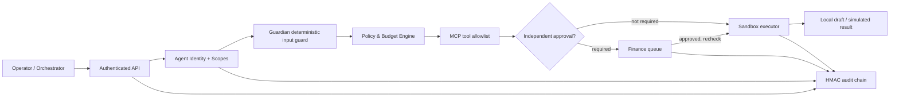

# GEBRID Enterprise OS — локальный исполняемый прототип v0.1

**Прототип по документу «GEBRID Enterprise OS: без криптовалюты и блокчейна» от 05.11.2026.**

Это **запускаемая end-to-end демосистема** на Python/FastAPI, SQLite и HTML/CSS/JavaScript. Она демонстрирует контроль агентных действий через серверный enforcement layer, а не обещает готовность к работе с реальными банками, ERP, клиентскими данными или автономными LLM. **Токены, NFT, кошельки и публичный блокчейн не используются.**

## Быстрый запуск

Требуется Python 3.11+.

```bash
cd gebrid-enterprise-os-prototype
python -m venv .venv
source .venv/bin/activate                 # Windows: .venv\Scripts\activate
pip install -r requirements.txt
python -m uvicorn gebrid.app:app --host 127.0.0.1 --port 8000
```

Откройте **http://127.0.0.1:8000**. Документация REST API: **http://127.0.0.1:8000/docs**. База и локальный HMAC-ключ создаются в `./data/` при первом запуске.

Альтернативный запуск Docker:

```bash
docker compose up --build
```

`docker-compose.yml` специально публикует только `127.0.0.1:8000`, не внешний сетевой интерфейс. Для остановки: `Ctrl+C` или `docker compose down`. Для сброса демонстрационных данных при локальном Python-запуске остановите сервер и удалите **только** `data/gebrid.db`; при Docker используется именованный том `gebrid_demo_data`.

## Демонстрационные учетные записи

**Никаких реальных учетных данных здесь нет. Демо-пароли намеренно доступны в исходниках.** На форме входа можно выбрать роль, чтобы заполнить поля.

| Роль | Логин | Пароль | Действия |
|---|---|---|---|
| Security Admin | `admin@gebrid.local` | `SecurityLead!2026` | Политики, инструменты, агенты, snapshots, migration, emergency stop, аудит |
| Operator | `operator@gebrid.local` | `OperatorDemo!2026` | Создание запросов, финансовые сценарии, workflow, Guardian-тесты |
| Finance Approver | `finance@gebrid.local` | `FinanceApprove!2026` | Одобрение и отклонение запросов; не может самостоятельно создавать запросы |
| Auditor | `auditor@gebrid.local` | `AuditRead!2026` | Только чтение audit и контрольных сумм snapshots |

Каждая роль получает отдельный bearer-session token сроком 8 часов. Токены хранятся в `sessionStorage` браузера и в виде SHA-256 дайджестов в SQLite. **Это демонстрационная авторизация, не Enterprise SSO.**

## Рабочие сценарии с ожидаемыми результатами

1. Войти как `operator@gebrid.local`, открыть **Invoice Control Lab** и выбрать `INV-1001`. Сумма $4 200, поставщик разрешен, банк подтвержден. Создается `DRAFT_ONLY` в локальной SQLite. Результат `EXECUTED` означает **только создание черновика**.
2. Выбрать `INV-1002` на $9 800. Результат `PENDING_APPROVAL`, черновик еще не создается. Выйти; войти как `finance@gebrid.local`; открыть **Approval Center**; одобрить. Запрос повторно проверяет policy, tool и бюджет. Только после этого создается локальный черновик.
3. Выбрать `INV-1003` — **DENIED**: реквизиты в счете отличаются от доверенного справочника. Никакое одобрение не обходит эту проверку.
4. Выбрать `INV-1004` — **DENIED**: $35 000 больше предела $25 000.
5. Выбрать `INV-1005` — **DENIED**: в недоверенном тексте счета есть распознаваемая prompt-injection инструкция.
6. Как администратор открыть **MCP Shield**, отключить `erp-sandbox`. Любой новый invoice draft станет `DENIED`, пока инструмент отключен.
7. Как администратор открыть **Agent Registry**, остановить `finance-agent` и проверить отказ. В **System Settings** активировать Global Emergency Stop — блокируются все новые действия.
8. В **Memory & Migration** создать JSON snapshot, затем сменить демонстрационную модель, оставив равный или меньший набор прав. Попытка добавить новое полномочие отклоняется HTTP 422; уже израсходованный бюджет остается прежним.
9. В **Audit Trail** нажать `Verify chain integrity`: проверка локальной HMAC-цепочки и хешей состояния.
10. В **Orchestrator** запустить `invoice-review` для `INV-1002`: шаги Finance Intake → Report Summary → Controlled Draft. Каждый шаг проходит отдельную проверку полномочий. Сумма > $5 000 вызывает ожидание Finance Approval.

**Повторная отправка одного и того же счета не создает второй черновик** и не создает второй параллельный запрос на его одобрение. Для произвольного API-вызова доступен `idempotency_key`.

## Что реализовано

| Компонент из концепции | Исполняемое поведение в этой сборке | Статус |
|---|---|---|
| Agent Identity / Registry | 5 именованных агентов, scope-списки, версии, статус, лимиты | Локально работает |
| Enterprise Policy Engine | Действие, scope, hard cap, allowlist, approval threshold, deny-by-default | Локально работает |
| Agent Firewall / Runtime Enforcement | Каждая sandbox-операция проходит централизованную проверку перед исполнением | Локально работает |
| MCP Shield | Реестр инструментов, active / disabled / quarantined, строгое сопоставление tool-policy | Локальная симуляция |
| Guardian Policy | Детерминированные сигнатуры suspicious input, ролевые и финансовые политики | Локально работает |
| Guardian AI / dual LLM | **Нет реальных вызовов LLM и независимого AI-рецензента** | Не реализовано |
| Approval Gate | Separate finance-approver, reject/approve, recheck policy version and limits | Локально работает |
| Continuity Vault | JSON snapshots, HMAC integrity, проверка перед migration | Локально работает |
| Migration Guard | Переход между **симулированными адаптерами**, scope subset, неизменность ID и бюджетов | Частично, симуляция |
| Agent Orchestrator | 2 последовательных workflow на фиксированных шаблонах | Локально работает |
| Verifiable Audit Trail | HMAC-chained события, recomputation и обнаружение локальной подмены | Локально работает |
| Enterprise Dashboard | Обзор, политики, статусы, демосценарии, approvals, migration и audit | Локально работает |
| ERP/CRM/1С/SAP/Microsoft 365 | Только синтетические локальные адаптеры | Реальных коннекторов нет |
| Banking | Никакого платежного API; только draft | Переводы сознательно отсутствуют |
| SaaS / Private Cloud / On-Prem | Контейнеризованный локальный демосервис | Не production deployment |
| Multi-tenancy, enterprise IAM, SSO, KMS, SIEM, HA, RBAC policy governance | — | Не реализовано |

## Схема контроля



Все действия, кроме специального безопасного чтения, ограничены связкой `agent_id + action + allowed tool + policy version`. Если scope или policy отсутствуют, решение **DENY**. Принцип исполнения: `AI proposes; independent policy authorizes or blocks`.

## Архитектура репозитория

```text
gebrid-enterprise-os-prototype/
├── gebrid/
│   ├── app.py                  # REST routes, RBAC, OpenAPI, static UI
│   ├── core.py                 # Policy engine, Guardian, approvals, migration, audit
│   └── db.py                   # SQLite schema, local demo seed
├── frontend/
│   ├── index.html
│   ├── styles.css
│   └── app.js                  # Dashboard + 10 feature pages + Invoice Lab
├── tests/
│   ├── test_system.py          # Automated API / security invariants
│   └── ui_smoke.cjs            # Offline UI route render smoke test
├── requirements.txt
├── requirements-dev.txt
├── Dockerfile
├── docker-compose.yml
├── RUNBOOK_RU.md
└── .env.example
```

## Тесты

```bash
pip install -r requirements-dev.txt
python -m pytest -q
node --check frontend/app.js
node tests/ui_smoke.cjs
```

**На момент сборки:** 22 API-теста и 11 offline smoke-checks интерфейсных разделов. Доступ к браузеру Chromium в среде сборки блокируется системной политикой URLBlocklist, поэтому полноценный headless E2E просмотр UI **не выполнен**; это ограничение верификации, а не подтверждение его прохождения. Клиентский JavaScript проверен синтаксически и на выполнение рендер-функций.

## Безопасность и ограничения

- **Не использовать** реальные корпоративные счета, персональные данные, банковские реквизиты и секреты. Все примеры синтетические.
- Сервер специально отказывается запускаться при `GEBRID_DEMO_MODE != 1`. Параметр `DEMO_MODE=0` **не превращает** демонстрацию в production.
- `Guardian` — набор предписанных эвристик. Он ловит некоторые очевидные инъекции, но не обеспечивает полную защиту от prompt injection.
- `MCP Shield` в этой версии управляет локальным реестром: удаленные MCP-серверы не подключаются, сетевой инструментальный sandbox не реализован.
- HMAC-цепочка проверяема локально, но **не является настоящим независимым tamper-proof журналом**. Администратор, получивший и базу, и HMAC-ключ, может ее переписать. Для production нужен внешний append-only store / внешний якорь и раздельное хранение ключей.
- Подмена памяти в SQLite обнаруживается, но защита от отката к более старой согласованной БД без внешнего monotonic anchor отсутствует.
- При миграции не передается реальная память LLM, долговременные сессии, токены внешних API и runtime state. Демонстрация проверяет только явные права, лимиты, внутренний snapshot и lineage.
- Single tenant, local SQLite, demo passwords, browser bearer-token, без настоящих SSO, MFA, rotation, KMS, WAF, telemetry и rate limiting. Код **не проходит независимый аудит**.
- Изолированный Docker-контейнер и локальный режим **не дают право** объявлять продукт безопасным для регулируемых банков.

## Следующие шаги до оплачиваемого пилота

1. Согласовать один процесс и его формальные действия с интегратором, выбрать реальный `read-only` source и test-only draft endpoint.
2. Заменить демонстрационные учетные записи на OIDC/SSO, Vault/KMS и RBAC с отдельным журналом администрирования.
3. Реализовать реальный MCP gateway или инструментальные прокси с sandbox isolation, таймаутами, egress allowlist, identity-bound credentials и replay protection.
4. Подключить адаптер к ERP / CRM **в клиентском sandbox**, ввести контрактные схемы запросов и проверку доверенного справочника реквизитов.
5. Реализовать независимую LLM-рецензию как дополнение к формальным policy, с prompt-injection red teaming и безопасным fallback.
6. Добавить настоящий model/runtime migration с версионируемой схемой состояния, подтверждением полноты данных и rollback semantics.
7. Вынести аудит во внешний immutable/WORM-журнал с независимым ключом; обеспечить экспорт доказательств и независимую верификацию.
8. Провести threat modeling, security code review, fuzzing, integration tests, пилотную приемку и оформить SLA/инцидентную процедуру.

Подробные пошаговые действия находятся в [RUNBOOK_RU.md](RUNBOOK_RU.md).
