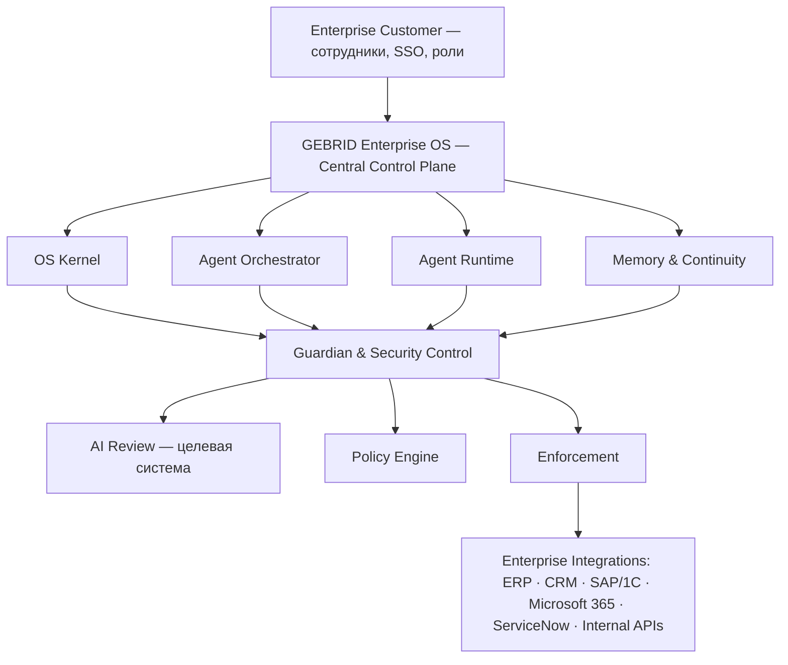
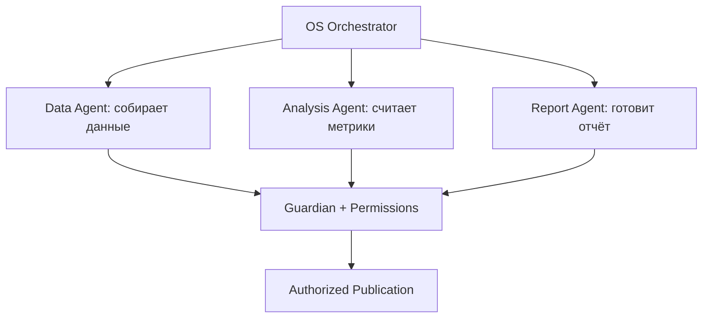
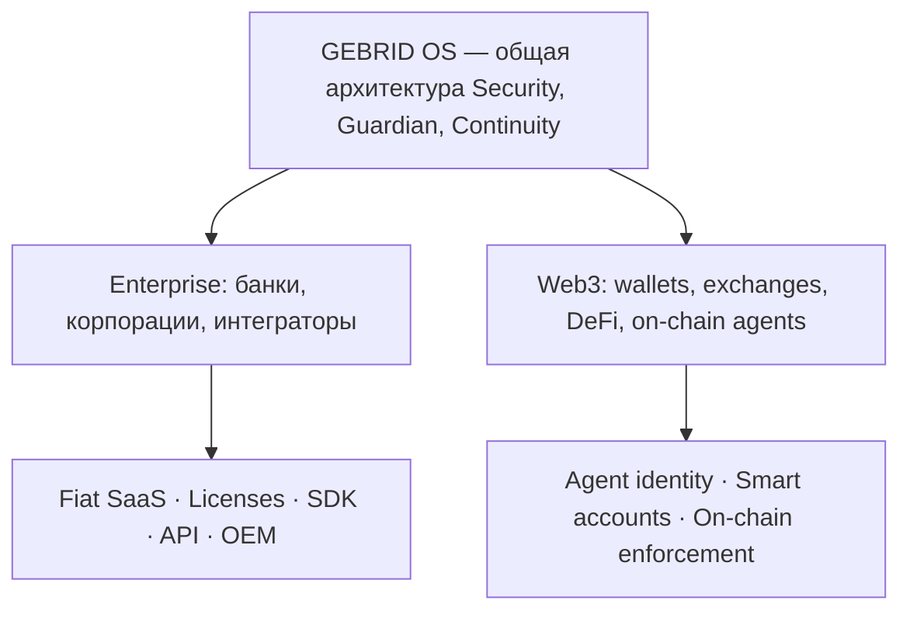

# GEBRID ENTERPRISE OS

## Полноценная операционная система для корпоративных AI-агентов без криптовалюты и блокчейна

**Статус:** концепция корпоративной продуктовой линейки, инженерные прототипы, коммерческие гипотезы.  
**Дата сводки:** 05.11.2026.  
**Источники:** документы GEBRID за июль–октябрь 2026 года, в том числе корпоративный пилот от 29.10.2026, модель «GEBRID Enterprise и токен» от 19.10.2026, investor pitch от 31.10.2026.

> **Главный принцип:** GEBRID Enterprise OS, Guardian Security, контроль полномочий и непрерывность AI-агентов должны быть доступны корпоративным клиентам без обязательных токенов, криптовалютных кошельков и публичного блокчейна. Корпоративная лицензия оплачивается обычной фиатной валютой.

Это самостоятельное коммерческое направление той же платформы GEBRID OS, а не отдельная криптовалюта или замена Web3-направлению.

---

## 1. Что такое GEBRID Enterprise

**GEBRID Enterprise — специализированная операционная платформа для управления корпоративными AI-агентами, их полномочиями, безопасностью, памятью, взаимодействием и выполнением действий во внутренних информационных системах.**

Представим компанию, которая использует 100 или 1 000 AI-агентов. Один работает с бухгалтерией, другой — с договорами, третий — с CRM, четвёртый — с закупками, пятый — с корпоративной почтой, шестой — с разработкой ПО. Каждый может обрабатывать данные, предлагать решения и выполнять разрешённые операции.

Проблемы, которые призван закрыть GEBRID:

1. Кто разрешил конкретному агенту доступ к данным?
2. Может ли агент отправлять документы третьим лицам?
3. Кто разрешает изменение банковских реквизитов?
4. Что произойдёт при подключении вредоносного инструмента?
5. Сохраняются ли ограничения при переходе между GPT, Claude или другой моделью?
6. Как немедленно остановить агента?
7. Можно ли восстановить проверяемую историю действий?
8. Кто контролирует действия нескольких агентов в одной задаче?

GEBRID позиционируется как **независимый Enterprise Agent Security & Continuity Control Plane** между AI-агентами и корпоративными системами. Он не обязательно заменяет ERP, IAM, SIEM или LLM, а добавляет контроль агентных действий и связывает системы в единый управляемый контур.

## 2. Криптовалюта корпоративному клиенту не требуется

| Компонент | GEBRID Enterprise | GEBRID Web3 |
|---|---|---|
| Операционная платформа | Да | Да |
| Guardian Security | Да | Да |
| Agent Orchestrator | Да | Да |
| Runtime и изоляция | Да | Да |
| Управление разрешениями | Да | Да |
| Memory Integrity | Да | Да |
| Migration Guard | Да | Да |
| MCP Security | Да | Да |
| Audit Trail | Да | Да |
| Криптовалютный кошелёк | Не требуется | По сценарию |
| Публичный блокчейн | Не требуется | По сценарию |
| NFT / ERC-6551 | Не требуется | Для on-chain identity |
| Токен $GEBRID | Не требуется | Возможен в будущей экономике |
| Оплата лицензии | USD/EUR или другая фиатная валюта | Фиат или поддерживаемые расчётные механизмы |

В корпоративной версии вместо NFT может использоваться внутренний идентификатор агента, связанный с корпоративным каталогом; вместо on-chain-реестра полномочий — подписанные политики и защищённая БД; вместо публичной транзакции — контролируемый вызов ERP/CRM.

Аудит может использовать цифровые подписи, хеши и хеш-цепочки **без криптовалюты**. Однако защита от изменения истории администратором требует дополнительного независимого хранения контрольных записей или другого якоря доверия.

## 3. Как будет устроена Enterprise OS

*Схема описывает целевую архитектуру. Перечисленные корпоративные коннекторы — возможные интеграции, не список готовых продуктов.*

### Основные корпоративные продукты

| Продукт | Назначение |
|---|---|
| **Agent Firewall** | Контроль опасных действий до исполнения |
| **MCP Shield** | Безопасное подключение инструментов, API и MCP-серверов |
| **Continuity Vault** | Защита критического состояния, памяти и истории агента |
| **Migration Guard** | Контроль переноса между моделями и окружениями |
| **Enterprise Control Plane** | Централизованное управление корпоративными агентами |

Общие функции для этих продуктов: Guardian, Identity, Permissions, Risk/Policy Enforcement, Audit и мониторинг. Не следует создавать дублирующие системы там, где можно использовать общее ядро.

## 4. Корпоративные сценарии использования

Перечислены ранее обсуждавшиеся сценарии и возможные расширения. **Это целевые применения, а не подтверждённые внедрения.**

### 4.1. Финансы, счета и корпоративное казначейство

Финансовый AI-агент получает счёт, сопоставляет его с ERP и договором, предлагает платёжный черновик. GEBRID проверяет реквизиты по независимому доверенному справочнику, полномочия, лимиты и разрешение финансового контролёра.

Это наиболее детально разработанный пилот. Локальный прототип от 29 октября проверяет счёт, требует одобрение отдельной ролью и создаёт **черновик**, а не реальный банковский перевод. Проверены повторные запросы, подмена реквизитов, лимиты и сохранение истории при смене тестового адаптера. Реальных денежных переводов нет.

### 4.2. Корпоративные закупки

Procurement Agent анализирует предложения поставщиков, сравнивает условия и формирует закупочную заявку. GEBRID ограничивает список approved suppliers, максимальные суммы, доступ к договорам и право отправки заказа. Например, агент может рекомендовать поставщика, но заказ сверх лимита требует одобрения. SAP, Oracle и 1С — возможные интеграции.

**Ценность:** контроль закупочных полномочий без передачи агенту неограниченного доступа.

### 4.3. Юридические отделы

Legal Agent читает договоры, выявляет противоречия, сравнивает редакции, готовит проекты документов и протоколов разногласий. GEBRID задаёт доступ к документам, адресатов, условия отправки и подтверждения. Например, агент может подготовить протокол, но не может сам принять коммерческие условия от имени компании.

Это концептуальное расширение, а не готовый промышленный GEBRID Legal.

### 4.4. IT, DevOps и разработка

Coding Agent читает репозитории, предлагает изменения, запускает тесты и создаёт pull requests. GEBRID ограничивает доступ к веткам, секретам, окружениям и инструментам. Агент может менять тестовую ветку, но не удалять production-базу или публиковать секреты без специальных полномочий.

Особенно применимы **MCP Shield** и **Agent Firewall**. Ограничения должны обеспечиваться исполнительным слоем, не только системным промптом.

### 4.5. Банки и страхование без криптовалюты

AI-агенты обрабатывают документы, заявки, обращения и внутренние процессы. GEBRID может контролировать отдельные действия: изменение реквизитов, выгрузку данных, изменение статусов, отправку документов. Нужны разделение обязанностей, роли, защита персональных данных, обязательные одобрения и проверяемый журнал.

**Важно:** соответствие банковским нормам, сертификация и production-готовность не подтверждены.

### 4.6. Контакт-центры и CRM

AI-агент анализирует обращение и историю клиента. Возможная политика:

| Действие | Пример правила |
|---|---|
| Просмотр статуса заказа | Разрешено при наличии доступа |
| Подготовка ответа | Разрешено |
| Изменение адреса доставки | Дополнительная проверка |
| Одобрение возврата | В пределах лимита |
| Удаление данных клиента | Запрещено без специальной роли |
| Внешняя выгрузка клиентской базы | Запрещено |

### 4.7. Корпоративные команды из нескольких агентов

Агенты могут работать параллельно, но их полномочия не должны неявно объединяться в неограниченный доступ.

## 5. Guardian для Enterprise

Guardian — не просто «вторая нейросеть, проверяющая первую», а набор независимых уровней контроля.

| Уровень | Функция | Подтверждённый статус |
|---|---|---|
| **Guardian AI** | Независимый анализ намерений, включая концепцию двух LLM | Исследование и проектирование |
| **Guardian Policy** | Формальные ограничения, бюджеты, получатели, сроки, права | Отдельные механизмы реализованы локально |
| **Guardian Enforcement** | Принудительная проверка перед исполнением | Локально протестированы конкретные сценарии; enterprise-интеграция не завершена |

**Пример:** агент предлагает изменить реквизиты поставщика. Guardian AI замечает риск, но окончательное решение определяется формальной политикой и обязательным подтверждением по доверенному каналу.

**Принцип:** AI предлагает; независимая система полномочий разрешает или блокирует.

### Защита от prompt injection

Целевая цепочка:

`Input Guard → Intent Parser → Policy Engine → Tool Allowlist → Human Approval → Execution`

Предварительный фильтр может выявлять манипуляции и опасные URL, но не должен быть единственным барьером: атакующий может переформулировать инструкцию или использовать иной инструмент.

## 6. Migration Guard: отдельная коммерческая ценность

Корпорации могут переключаться между GPT, Claude, Gemini и локальными моделями. При смене модели, инструмента или окружения ранее установленные права и обязательства должны продолжать действовать.

| Свойство | Требование |
|---|---|
| Identity Continuity | Агент остаётся той же управляемой сущностью |
| Permission Preservation | Новые полномочия не шире старых |
| Memory Integrity | Критические данные не изменены незаметно |
| Budget Continuity | Накопленные ограничения не обнуляются |
| Credential Safety | Старые доступы не могут использоваться несанкционированно |
| Audit Lineage | История операций сохраняет связь |

Основной инвариант:

\[
Permissions_{new} \subseteq Permissions_{old}
\]

В октябрьском invoice-пилоте локально проверяли сохранение лимитов при смене **fixture-адаптера** и переодобрение незавершённых действий. Это **не** доказательство полной миграции настоящего автономного агента с памятью между GPT и Claude.

## 7. Форматы внедрения

| Модель | Как работает | Тип клиента |
|---|---|---|
| **SaaS** | Сервис размещён у поставщика | Интеграторы и малые/средние компании |
| **Private Cloud / VPC** | Выделенный облачный контур клиента | Средние и крупные предприятия |
| **On-Premises** | Компоненты находятся в инфраструктуре заказчика | Регулируемые организации |
| **SDK / API** | Контроль встраивается в продукт клиента | Разработчики, агентные платформы |
| **OEM / White Label** | Партнёр лицензирует и распространяет функциональность | IT-вендоры |

Данные и секреты клиента потенциально могут оставаться в его инфраструктуре. Но локальное размещение GEBRID не делает автоматически локальными внешние LLM. Все пять режимов — целевая модель поставки, а не пять уже испытанных production-продуктов.

## 8. Монетизация без криптовалюты

### 8.1. Лицензии Enterprise OS

| Тариф / контракт | Обсуждавшийся ориентир | Возможное содержание |
|---|---:|---|
| Starter | $500–1 500/мес. | Базовый контроль ограниченных workflows |
| Business | $5 000–15 000/мес. | Политики, мониторинг, интеграции |
| Enterprise | $100 000–500 000+/год | Выделенный контур, расширенное управление, SLA |
| OEM | Индивидуально | Встраивание в платформу партнёра |

Это коммерческие гипотезы, **не текущий утверждённый прайс-лист и не состоявшиеся сделки**.

В сценарной модели от 19 октября использовались более высокие предположения: **$600 000/год за Enterprise** и **$1,8 млн/год за OEM**. Они предполагают широкий объём поставки, которого у локального пилота пока нет.

### 8.2. Usage-based API

Варианты измерения: проверки полномочий, обращения к MCP Gateway, Guardian evaluations, контролируемые действия, миграции.

Пример из модели: $0,005 за дополнительную проверку. При 100 млн платных проверок за месяц:

`100 000 000 × $0,005 = $500 000 в месяц`

Это сценарий, не доказанный тариф или объём использования.

### 8.3. Платный пилот

**Рабочий оффер от 29.10.2026:** $5 000 за четыре недели **после получения данных и sandbox**.

- Один корпоративный процесс.
- Один реальный адаптер источника.
- Один тестовый endpoint для создания черновиков.
- Политики доступа, негативные проверки, журнал, передача.
- Ориентир инженерных работ — 40 часов, расширение scope оплачивается отдельно.
- Предложенная оплата: $2 500 до начала, $2 500 после приёмки.
- После пилота обсуждается условная подписка $1 500/мес.

Условия **не подтверждены клиентом** и не являются подписанным контрактом.

**Экономическая гипотеза:** 3 000 счетов/мес. × 120 секунд сэкономленного времени × $40/час = $4 000/мес. условной стоимости высвобождённого времени. При регулярных затратах $1 750 и распределённой стоимости пилота $416,67 разница ≈ $1 833/мес. Это не подтверждённая фактическая экономия и не обязательно прямое сокращение денежных затрат.

## 9. Финансовый потенциал Enterprise независимо от токена

**Сценарий полного масштаба из модели от 19.10.2026; это не прогноз и не выручка GEBRID.**

| Поток | Условный портфель | Годовая выручка |
|---|---|---:|
| Enterprise ACL + Guardian | 20 × $600 000 | $12 млн |
| OEM | 5 × $1,8 млн | $9 млн |
| Отраслевые лицензии | 10 × $300 000 | $3 млн |
| API overages | 100 млн проверок/мес. × $0,005 | $6 млн |
| **Итого** | | **$30 млн** |

В модели предполагаются прямые затраты 20% ($6 млн) и операционные расходы $9 млн, что даёт **условную EBITDA $15 млн**. Для фактического применения требуется подтвердить клиентов, условия поставки, ценообразование, затраты и отсутствие двойного учёта OEM, отраслевых лицензий и API-потребления.

Основной вывод: корпоративная лицензионная экономика может существовать **без продажи токена** и независимо от его биржевой цены.

## 10. Реальная техническая готовность на ноябрь 2026 года

| Система | Подтверждено материалами | Что остаётся |
|---|---|---|
| EVM Security Kernel v2 | Внутренний отчёт о 189 локальных контрактных тестах | Независимый аудит, production-проверка |
| Invoice Control Pilot | Локальная демонстрация на синтетических счетах, ролях и SQLite | Реальные ERP/LLM/клиентский sandbox |
| Guardian AI | Архитектура | Две LLM, проверка качества и устойчивости |
| Enterprise Policy Engine | Отдельные локальные правила в прототипе | Единый промышленный сервис |
| MCP Shield | Локальный security admission-прототип | Production MCP Gateway |
| Migration Guard | Сохранение ограничений при смене fixture-адаптера | Реальная миграция моделей и памяти |
| Agent Orchestrator | Спецификация | Интегрированный runtime |
| Enterprise Dashboard | Интерфейсы/демо и спецификации | Реальные данные и контроль |
| SaaS / Private Cloud / On-Prem | Варианты поставки | Развёртывание и приёмка |
| Enterprise-клиенты | Сегменты и коммерческие гипотезы | Оплаченные договоры |

Нельзя объединять результаты EVM-тестов и invoice-стенда в утверждение о промышленной готовности полной Enterprise OS. **Ближайший реалистичный предмет продажи — ограниченный пилот контроля конкретного корпоративного процесса.**

## 11. Кому продавать первым

Из документа от 29 октября: первый выбранный сегмент — **интеграторы корпоративной автоматизации, которые уже создают AI-агентов с доступом к внутренним системам**. Это проще и конкретнее, чем сразу идти во все крупные банки.

| Сегмент | Предложение | Причина |
|---|---|---|
| AI / Enterprise интеграторы | Agent Firewall + Invoice Controls | Можно проверить один реальный процесс |
| Поставщики Agent Platforms | MCP Shield + Runtime Enforcement | Дополнительная безопасность в их продукте |
| Enterprise IT | Control Plane + Audit | Управление агентами организации |
| Финансовые подразделения | Guardian + Policy Controls | Контроль платёжных workflows |
| Крупные IT-вендоры | OEM / SDK | Масштабирование через платформу партнёра |

Коммерческий эксперимент: **10 квалифицированных разговоров и минимум один реально оплаченный пилот**. Требуются подтверждённая проблема, владелец бюджета, доступный sandbox и решение об оплате. Похвала демонстрации не равна покупке.

## 12. Позиционирование для корпоративного рынка

> **GEBRID Enterprise OS**  
> **Secure Operating System for Enterprise AI Agents**
>
> GEBRID enables organizations to deploy, manage and govern autonomous AI agents across internal applications, data and workflows.
>
> Its security architecture combines agent identity, enforceable permissions, Guardian controls, runtime protection, MCP security, continuity and verifiable auditability.
>
> Designed for SaaS, private-cloud and on-premises deployment, GEBRID Enterprise does not require cryptocurrency, tokens, NFTs or a public blockchain for its core functionality.
>
> The platform targets controlled autonomy: AI agents can propose and perform authorized work, while independent policies enforce the limits set by the organization.

*Это целевое позиционирование, а не утверждение, что все элементы уже интегрированы и доступны в production.*

Корпоративный клиент должен иметь возможность безопасно автоматизировать процессы без замены существующей ERP, банковской и IT-инфраструктуры и без внедрения Web3.

## 13. Как связаны Enterprise и BingX / Web3

- **Enterprise** платит компании обычными договорами за лицензии, интеграции и поддержку.
- **Web3** использует дополнительные on-chain механизмы и потенциальную будущую токеновую экономику.
- Общие исследования, технологии и IP обеспечивают развитие обеих линий.

**Предостережение:** корпоративная выручка не создаёт автоматического права на прибыль, дивиденды или требование к компании для владельцев токена $GEBRID. Любая подобная связь требует отдельной юридической, экономической и технической спецификации.

Для BingX Enterprise-направление показывает возможность B2B-дохода независимо от спекулятивного спроса на токен. Но не заменяет обоснование utility токена и требования биржи.

## 14. Что добавить в итоговый BingX pitch deck

### Слайд A: GEBRID Enterprise — Beyond Crypto

Показать реальные целевые сегменты: финансы, закупки, разработка, корпоративные данные, CRM и команды агентов. В центре — Guardian + Policy Enforcement.

**Ключевая строка:** `No token, wallet or public blockchain required.`

### Слайд B: Two Commercial Markets, One Technology

Две ветки: Enterprise (SaaS, API, OEM и лицензии в фиате) и Web3 (on-chain identity, accounts, enforcement и будущая токеновая экономика). Основа — общий Security Kernel, Guardian, ACL, Memory Integrity, Audit.

Можно упомянуть первоначальный $5 000 invoice-пилот как коммерческую гипотезу, **не как состоявшуюся продажу**, а цены крупных Enterprise — только как модельные сценарии.

---

## Итог и рекомендуемая последовательность

**GEBRID Enterprise следует разрабатывать как самостоятельный B2B-продукт, не зависящий от токена и крипторынка.**

1. Подтвердить платную потребность в контроле одного корпоративного процесса.
2. Довести Agent Firewall / Policy Enforcement до интеграции с реальными системами заказчика.
3. Проверить изоляцию, роли, человеческие одобрения и независимый аудит.
4. Развивать MCP Shield и Migration Guard на реальных адаптерах и моделях.
5. Масштабировать Enterprise Control Plane, Orchestrator и Runtime после подтверждения спроса.

**Итоговое позиционирование:** GEBRID — Agent OS для корпоративного AI и Web3, а не продукт, которому обязательно нужна криптовалюта для работы.

## Источники из Google Drive

- [GEBRID Invoice Pilot Manual RU, 29.10.2026](https://drive.google.com/file/d/1DKEQRlVvwEW5PRLxYAv-Os5Q1GCCScxM/view)
- [GEBRID Investor Pitch, 31.10.2026](https://drive.google.com/file/d/1_YHexZ2FoR4f-Xu3O3JvL0JZYYDyZ3ou/view)
- [GEBRID Enterprise и токен — модель от 19.10.2026](https://drive.google.com/file/d/1T5EpCAEIbg1QmSLr4P7kBlu190IB3tk4/view)
- [GEBRID Security Kernel Execution Report, 23.10.2026](https://drive.google.com/file/d/1F5F1T3N60_yuwFVkXKQlIcWVdn1fkHXM/view)
