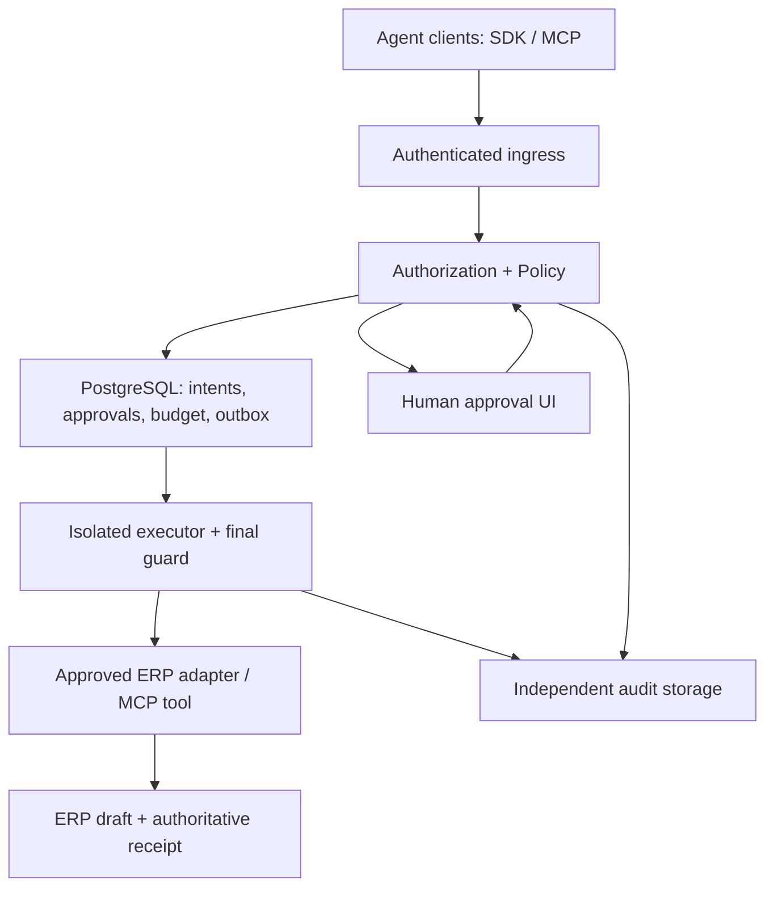
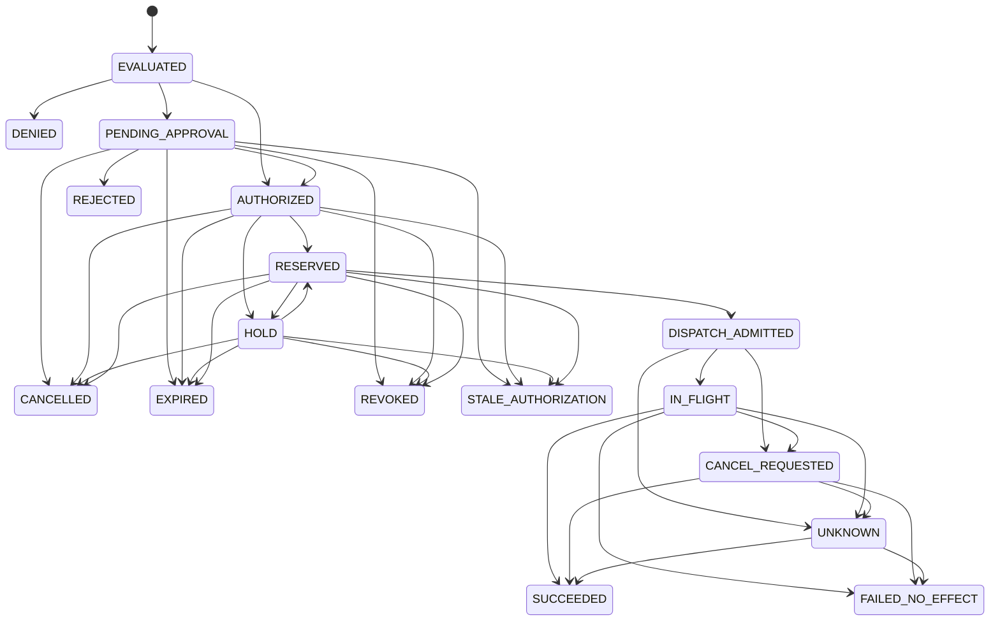

# GEBRID Agent Firewall — полное техническое задание до готовности 10/10

**Версия ТЗ:** 1.1 (ревизия v1.0 от 07.11.2026). **Дата:** 07.11.2026, Москва. **Исходная сборка:** GEBRID Enterprise OS Prototype v0.2.0 — см. §1: в доступных материалах не найдена, требует подтверждения (задача M0-00).

**Статус:** проектные требования для реализации и приёмки. Новые функции, показатели и испытания ниже являются заданиями, а не уже полученными результатами.

**Целевой результат:** самостоятельный промышленный Agent Firewall, который принудительно контролирует действия AI-агентов в согласованном корпоративном контуре: кто действует, над каким ресурсом, каким инструментом, с какими параметрами, лимитами и одобрениями; что фактически произошло и как это независимо проверить.

## 0. Что означает 10/10

10/10 означает закрытие всех обязательных требований этого ТЗ на конкретном commit, конфигурации, версии протокола, наборе адаптеров и профиле развёртывания. Это критерий приёмки ограниченного продукта, а не обещание отсутствия любых будущих уязвимостей.

Целевой профиль **Dedicated Production**: выделенный контур одной компании в её VPC или on-premises; разделение подразделений/workspaces; человеческие пользователи через корпоративный IdP; отдельные identity сервисов; PostgreSQL; изолированные исполнители; независимо защищённое хранение аудита; эксплуатация по runbook. Базовый промышленный процесс — чтение счёта и создание черновика в одной реальной ERP. Автономные банковские переводы в релиз 1.0 не входят.

Публичный SaaS для множества независимых компаний, токен, блокчейн, marketplace, универсальный orchestrator, полноценный перенос памяти LLM и обязательная dual-LLM Guardian не являются зависимостями этого релиза. Фильтры AI могут добавлять ограничения и запросы одобрения, но право исполнения определяется формальными правилами.

При изменении адаптера, семантики действия, схемы инструмента, способа аутентификации или границы исполнения затронутые критерии проверяются повторно. Новая критическая уязвимость отзывает статус готовности соответствующего релиза до исправления.

## Лист изменений v1.0 → v1.1

Ревизия выполнена 07.11.2026 по тексту v1.0 (SHA-256 `21e264d073dec9165e9fb7e184dc481a2f65f451c28caf6159af3a334dadb49b`). Статусы: **ПРОВЕРЕНО** — проверено исполнением или по первоисточнику в этой ревизии; **ИЗ ИСТОЧНИКА** — взято из документа без перепроверки; **ОЦЕНКА** — суждение ревьюера.

| # | Где | Что изменено | Почему | Статус |
|---|---|---|---|---|
| 1 | §1, §25.1, M0 | Исходная точка v0.2 помечена как неподтверждённая; добавлена задача M0-00 | Архив v0.2 (SHA `cf9697f9…`), отчёт Readiness v0.2, `tests/test_authorization.py`, `RELEASE_MANIFEST.json`, `evidence/` не найдены ни во вложениях, ни в репозитории `Gebrid-spec/GebridMVP` (все ветки и история). Ссылки §25.1 ведут в личную библиотеку chatgpt.com и недоступны разработчикам и ревьюерам | ПРОВЕРЕНО (отсутствие) |
| 2 | §1 | Добавлена параллельная линия v0.1.1 и обязательная сверка с ней | В ветке `ccr-dc8df4ad-s47q7b` есть v0.1.1 с исправлениями, которых может не быть в v0.2: обход согласования одним admin, ослабление политики без второго лица, снятие лимита и allowlist, HTTP 500 на `purchase.create` | ПРОВЕРЕНО (по коду и тестам v0.1.1) |
| 3 | §8.1, UI-03 | Машина состояний дополнена: `HOLD`, `DISPATCH_ADMITTED`, `CANCEL_REQUESTED`, `STALE_AUTHORIZATION`, ребро `RESERVED → CANCELLED`, ручная сверка `UNKNOWN`; добавлена таблица переходов | В v1.0 состояния `CANCEL_REQUESTED`, `HOLD`, `STALE_AUTHORIZATION` использовались в тексте, но отсутствовали в диаграмме; APR-05 разрешал cancel до admission, а из `RESERVED` в `CANCELLED` перехода не было; граница отзыва §9.1 (commit admission) не была отдельным состоянием; из нового `DISPATCH_ADMITTED` добавлен выход в `UNKNOWN` на случай потери executor до подтверждённой отправки | ПРОВЕРЕНО (скриптом по тексту) |
| 4 | §7, §17, §18 | POL-13, POL-14, INV-21, T65–T68: разделение ролей и неснимаемые лимиты как регрессия v0.1.1 | Дефекты воспроизводились на прототипе: admin поднял порог согласования и провёл INV-1002 с `approved_by = null`; `max_amount = null` + пустой allowlist превращали $35 000 в ALLOW | ПРОВЕРЕНО (воспроизведено на v0.1) |
| 5 | §18 | T69: многоязычный и homoglyph-корпус prompt injection | На прототипе эвристика пропускает перефразировку, кириллическую «о» и русский текст; для русскоязычных клиентов это основной сценарий | ПРОВЕРЕНО (на v0.1) |
| 6 | §5.3 | CR-11: криптографический профиль с возможностью ГОСТ | CR-06 фиксировал только ES256; часть российских заказчиков может требовать ГОСТ Р 34.10-2012 / 34.11-2012 и СКЗИ. Применимость определяет заказчик | ОЦЕНКА |
| 7 | новый §16.1 | REG-01…REG-05: регуляторный профиль РФ | ТЗ ориентировано на Москву и RUB, но не упоминало 152-ФЗ, требования ФСТЭК и КИИ. Перечень норм приведён по знаниям ревьюера и подлежит подтверждению юристом заказчика | ОЦЕНКА |
| 8 | §12 | AUD-13: персональные данные вне неизменяемого журнала | Append-only аудит конфликтует с удалением ПДн по запросу субъекта, если ПДн попадают в события | ОЦЕНКА |
| 9 | §6, §15 | IAM-13 (bootstrap доверия), OPS-15 (источник времени), OPS-16 (реестр требований в CI) | §14.2 ссылался на «доверенный bootstrap» без определения; NFR-06 ограничивал рассинхронизацию часов без источника времени; §19 требовал поэлементной трассировки без механизма её проверки | ПРОВЕРЕНО (по тексту) |
| 10 | §13 | API-05 (SDK), UI-09 (локализация RU/EN) | SDK есть на схеме §4, но без требований; демо уже двуязычное, reason codes должны оставаться машинными | ПРОВЕРЕНО (по тексту) |
| 11 | §18 | T70 (окна отзыва IAM-09), T71 (крипто-профили), T72 (удаление ПДн), T73 (реестр требований) | Для IAM-09 не было отдельного теста | ПРОВЕРЕНО (по тексту) |
| 12 | §22 | Определены шкала severity и критерии независимости ревью | §22 опирался на Critical/High/Medium без определения | ПРОВЕРЕНО (по тексту) |
| 13 | §11 | Уточнены нормативные имена механизмов MCP 2026-07-28 | Утверждения v1.0 о MCP подтверждены по официальному репозиторию спецификации (коммит `cf59bb0d`, 07.11.2026); добавлены точные имена: `InputRequiredResult`, `requestState`, правила `x-mcp-header` | ПРОВЕРЕНО (первоисточник) |
| 14 | §20.2 | Добавлен резерв и точка пересмотра после M1 | 80–132 человеко-дня на OIDC, KMS, MCP gateway, PostgreSQL ledger, внешний аудит, HA, нагрузку и пилот — плотная оценка | ОЦЕНКА |
| 15 | §10, §23 | Опросник выбора ERP (INT-13) | Выбор ERP определяет выполнимость LED-10/INT-05; без проверки возможностей до M1 риск переделки | ОЦЕНКА |

Внутренняя целостность v1.0 проверена скриптом: все 64 теста T01–T64 определены и на каждый есть ссылка; 164 требования без пропусков в нумерации; ссылки INV → T указывают только на существующие тесты. **ПРОВЕРЕНО.**

## 1. Подтверждённая исходная точка

SHA-256 исходного архива v0.2: `cf9697f94d3b08ebb7482a06e06193fc71b522c98ae7291df141f1a93be6e778`.

Основание: текущий отчёт `GEBRID_Enterprise_Readiness_v0.2_2026-11-07.md`, исходники `gebrid/core.py`, `app.py`, `db.py`, тесты и manifest v0.2. В рамках подготовки ТЗ новые продуктовые тесты не запускались; приведённые результаты относятся к предыдущей проверке v0.2.

> **Статус раздела в v1.1: ИЗ ИСТОЧНИКА, не перепроверено.** Архив v0.2 с указанным SHA-256, отчёт Readiness v0.2, `tests/test_authorization.py`, `RELEASE_MANIFEST.json` и `evidence/` отсутствуют в репозитории и вложениях. Таблица ниже описывает v0.2 со слов отчёта. До закрытия M0-00 её нельзя использовать как подтверждённую базу.

**Параллельная линия v0.1.1 (проверена).** В репозитории `Gebrid-spec/GebridMVP`, ветка `ccr-dc8df4ad-s47q7b`, каталог `enterprise-os-prototype/`, находится v0.1.1: 30 серверных тестов, браузерная демо-версия, сверенная с Python-сервером на 122 сценариях. Функций v0.2 из таблицы (cancel, expiry, ActionEnvelope, emergency epoch, receipts) в v0.1.1 нет. Зато в v0.1.1 исправлены четыре дефекта, о которых в v0.2 ничего не известно:

| Дефект v0.1 | Как исправлено в v0.1.1 | Регрессионный тест v1.1 |
|---|---|---|
| Admin менял порог согласования и сам подавал запрос: INV-1002 исполнялся без approver | Подавать запросы может только operator | T65 |
| Ослабление политики применялось одним человеком | Ослабление ждёт approver; ужесточение применяется сразу; устаревшее предложение → `STALE_POLICY` | T66 |
| `max_amount = null` и пустой allowlist открывали любую сумму и получателя | Для денежных действий лимит и allowlist обязательны (HTTP 422) | T67 |
| Любой разрешённый `purchase.create` возвращал HTTP 500 | Исправлена ошибка в исполнителе | T68 |

**M0-00 (блокирует M0).** Положить архив v0.2 в репозиторий, сверить SHA-256 с указанным выше, прогнать его тесты и зафиксировать результат. Затем перенести исправления v0.1.1 в v0.2 или доказать, что v0.2 их уже содержит: T65–T68 должны проходить на baseline-коммите v1.0-ветки.

| Область | Что уже есть | Что необходимо изменить |
|---|---|---|
| Policy / RBAC | Серверные правила, scopes, allowlist, отдельный approver | Корпоративная identity, привязка к workspace, управление политиками и правами |
| ActionEnvelope | Локальная HMAC-подпись, параметры, версии, expiry | Межсервисный контракт, стандартная канонизация, раздельные ключи и проверка получателем |
| Lifecycle | Pending, approve/reject/cancel, expiry, версии агента и инструмента, emergency epoch | Полная машина состояний внешнего эффекта, согласования, reservations и reconciliation |
| Исполнение | Синтетический результат и SQLite-транзакция | Реальный ERP adapter и обязательный путь через изолированный executor |
| Повторы / деньги | Локальная receipt, idempotency, Decimal-нормализация | Целочисленный денежный ledger, конкурентное резервирование и внешняя идемпотентность |
| MCP | Локальный registry и quarantine | Аутентифицированный gateway, schema/argument binding и egress enforcement |
| Audit | Локальная HMAC-цепочка | Независимое хранение, контроль удаления/усечения и отдельный verifier |
| Проверки | 51 серверный тест; 27 localhost HTTP-сценариев; 11 offline UI-экранов и 3 lifecycle-сценария (ИЗ ИСТОЧНИКА; для v0.1.1 проверено: 30 тестов) | Реальная интеграция, браузерный E2E, fault injection, нагрузка, внешний security review |
| Поставка | FastAPI, SQLite, demo-учётки и локальные ключи | Production-профиль без demo seed, воспроизводимая сборка и эксплуатационная приёмка |

В `db.py` денежные поля остаются REAL. `jdump(sort_keys=True)` не объявляется реализацией RFC 8785. Локальная транзакция и receipt не обеспечивают однократность внешнего ERP-эффекта. Первые пять этапов прежней локальной шкалы подлежат повторной проверке после изменения архитектуры.

## 2. Объём релиза и пользовательские сценарии

### 2.1. Обязательный процесс

1. Агент с установленной identity читает счёт из разрешённого источника.
2. Система получает версию счёта и доверенную карточку поставщика независимо от текста документа.
3. Агент предлагает создать черновик: supplier ID, сумма, валюта, назначение и разрешённая целевая ERP.
4. Firewall проверяет полномочия, данные, лимиты, инструмент и необходимость подтверждения.
5. Approver видит фактический эффект и подтверждает конкретную неизменяемую версию запроса.
6. Исполнитель повторно проверяет разрешение, резервирует бюджет и выполняет ограниченный ERP-вызов.
7. Результат связывается с ERP object ID и проверяемой квитанцией; повтор не создаёт второй черновик.
8. При неоднозначном результате исполнение переходит в UNKNOWN до сверки с ERP.

### 2.2. Поддерживаемые действия

| Действие | Объём релиза 1.0 | Условие |
|---|---|---|
| `invoice.read` | Обязательно | Доступ к определённому набору счетов и полей; чтение тоже проходит authorization |
| `invoice.draft` | Обязательно | Только черновик; нет отправки платежа или подписания обязательства |
| `purchase.create` | Дополнительный адаптер | Включается в production только после отдельного контракта эффекта и всех его тестов |
| `contract.send`, `report.publish`, `repo.pr.create` и другие действия из demo | Вне обязательной промышленной поставки | В production по умолчанию отключены; наличие demo не считается готовым коннектором |
| `bank.transfer`, `payment.execute` | Вне релиза | Unknown action → DENY; расширение требует отдельного ТЗ и приёмки |

Для каждого включённого действия обязательны schema, effect projection, risk class, source of truth, разрешённые ресурсы, credentials, idempotency contract, recovery и тестовая матрица. «Произвольный HTTP/SQL/shell» в перечне production tools запрещён.

## 3. Граница доверия и модель угроз

### 3.1. Граница ответственности

LLM, сообщения пользователя, документы, описания инструментов, tool output и переданный клиентом `agent_id` сами по себе не являются источниками полномочий. Сеть и credentials должны исключать обход исполнительного слоя.

В доверенный контур входят: корпоративный IdP и настроенные issuers; authoritative policy/ledger; signer с ограниченной identity; зарегистрированные исполнители и утверждённые ERP endpoints; отдельная инфраструктура аудита. Для каждой границы в threat model фиксируются владелец и последствия компрометации.

Полный контроль атакующего над всеми узлами, ERP, IdP и ключами одновременно находится за пределами гарантии продукта. Продукт обязан сохранять свидетельства и обнаруживать предусмотренные нарушения в пределах заявленной модели угроз. Реальный эффект у заведомо злонамеренного внешнего сервиса нельзя доказать одной его неподтверждённой self-report квитанцией.

| Угроза | Обязательное противодействие | Приёмочное доказательство |
|---|---|---|
| Prompt injection в счёте или tool output | Данные не изменяют policy, recipients, credentials и approvals | Инъекция не создаёт запрещённого эффекта даже при пропуске текстового фильтра |
| Кража клиентского bearer token | Audience, короткий срок, sender binding для workload, отзыв | Токен другого сервиса/клиента отвергнут |
| Подмена агента или workspace | Identity связывается сервером с tenant/workspace/agent | Перебор чужих IDs не даёт доступ |
| Tool poisoning, смена schema/endpoint | Admission revision, schema/effect digest, quarantine | Старое разрешение не исполняется новым инструментом |
| Повторы, гонки, worker split-brain | Unique intent, reservations, fencing и внешняя дедупликация | Параллельные исполнители не создают лишний эффект |
| Таймаут после записи в ERP | UNKNOWN, статус по business key, reconciliation | Нет слепого повторного POST |
| Злоупотребление admin | Разделение policy editor, reviewer, approver и audit admin | Один пользователь не выдаёт себе право и не стирает след |
| SSRF / DNS rebinding / data exfiltration | Endpoint registry, сетевой egress deny, ограничения discovery и вывода | Запрещённые адреса и маршруты не достигаются |
| Усечение/откат БД и журнала | Независимые high-water marks, checkpoints и восстановление со сверкой | Старый согласованный snapshot не выглядит актуальной историей |

## 4. Целевая архитектура



### 4.1. Компоненты

| Компонент | Ответственность | Доступ |
|---|---|---|
| Ingress / BFF | OIDC, workload auth, request limits, CSRF, correlation | Не хранит ERP credentials и не исполняет эффекты |
| Identity / Policy | Principal mapping, typed policy, revisions, decision | Читает authority state; не может удалять независимый audit |
| Approval service | Отображение effect projection, решения и quorum | Не изменяет payload и не выдаёт себе роли |
| Ledger / outbox | Состояния, idempotency, reservations, dispatch admission | PostgreSQL constraints и транзакции; write-доступ по сервисным ролям |
| Signer | Выпуск разрешений заданного типа | KMS/защищённый signer; ключи не экспортируются в web или agent runtime |
| Executor | Final guard, lease/fence, credentials, контролируемый вызов | Единственный компонент с доступом к ERP write endpoint |
| Reconciler | Сверка UNKNOWN и незавершённых операций | Read/status API ERP, изменение ledger через ограниченный интерфейс |
| Audit exporter / verifier | Независимое хранение, проверка подписи, пропусков и rollback | Отдельные права записи/чтения; приложение не может сокращать retention |

### 4.2. Технологическая база

Сохранить Python/FastAPI для API и доменной логики. Production persistence — PostgreSQL с версионируемыми миграциями; SQLite остаётся только в demo/быстрых тестах. Начальная очередь — PostgreSQL transactional outbox с worker lease. Redis, Kafka, Kubernetes и новый платный сервис не вводятся автоматически: они допустимы только по измеренной потребности и отдельному ADR.

Исполнители запускаются отдельно от LLM runtime и UI, с минимальными filesystem/process/network правами. Production-профиль поддерживает несколько экземпляров API/executor; политика лидерства PostgreSQL и failover фиксируется в deployment ADR. Общие secret, root-role и неограниченный DB superuser для всех компонентов запрещены.

## 5. Контракты данных и криптография

### 5.1. ActionEnvelope v2

Обязательные группы полей:

| Группа | Поля |
|---|---|
| Формат | `schema_version`, `type`, `envelope_id`, `created_at`, `expires_at` |
| Identity | `tenant_id`, `workspace_id`, `principal_id`, `agent_id`, `agent_revision`, `workflow_id`, `delegation_chain_digest` |
| Эффект | `action`, `resource_type`, `resource_id`, `resource_revision`, `resource_digest`, `arguments_digest`, `effect_digest` |
| Инструмент | `tool_id`, `tool_admission_revision`, `tool_schema_digest`, `endpoint_id`, `adapter_version`, `credential_binding_id` |
| Полномочия | `policy_bundle_digest`, `policy_revision`, `grant_revision`, `control_epoch`, `obligations_digest` |
| Лимиты | `currency`, `amount_minor`, `budget_account_ids`, `budget_period_id` — для денежных действий |
| Повторы | `intent_id`, `idempotency_scope`, `idempotency_key_digest` |

`tenant_id`, identity, версии, hash и время заполняет доверенный сервер. Клиент передаёт предложение действия, но не готовое разрешение. Поля, неприменимые к действию, задаются по однозначной schema; отсутствие и `null` не взаимозаменяются молча.

Пример фрагмента effect projection, а не действующий подписанный документ:

```json
{
  "schema_version": "gebrid.effect.invoice-draft.v1",
  "action": "invoice.draft",
  "erp_endpoint_id": "erp-sandbox-01",
  "invoice_id": "INV-1002",
  "invoice_revision": "7",
  "supplier_id": "SUP-NOVA",
  "trusted_recipient_revision": "3",
  "currency": "USD",
  "amount_minor": "980000",
  "payment_sent": false
}
```

### 5.2. ExecutionTicket v1

Ticket выпускается только для прошедшего проверки intent. Содержит `ticket_id`, `intent_id`, `envelope_digest`, `approval_set_digest`, `reservation_ids`, `executor_audience`, `nonce`, `not_before`, `expires_at`, `control_epoch`, `fence_token`, `type` и `schema_version`. Ticket не является OAuth access token и не заменяет workload authentication.

Ticket разрешает один логический эффект с конкретным payload. Транспортные попытки того же эффекта подчиняются idempotency contract адаптера; новый nonce или JSON-RPC request ID не создают новый business intent. Повторная выдача после сбоя сохраняет один logical intent, учитывает попытки и отменяет прежнюю lease/fence.

### 5.3. Обязательные правила

| ID | Требование | Критерий готовности |
|---|---|---|
| CR-01 | Канонические bytes — RFC 8785 JCS проверенной библиотекой; общий corpus для Python и Node | Совпадающие bytes/digests на golden vectors; обычный `sort_keys` не принимается как доказательство |
| CR-02 | Duplicate JSON keys, NaN/Infinity, некорректный Unicode и неизвестные обязательные поля отклоняются | Ошибка до policy и побочного эффекта; одинаковая семантика у ingress и executor |
| CR-03 | Unicode не нормализуется незаметно после подписи; tool/resource identity имеют строгие правила сравнения | Пары похожих символов не смешивают principals и инструменты |
| CR-04 | Денежные значения в контракте — строка целых minor units: `0` или число без ведущих нулей; в БД BIGINT с проверкой переполнения | Нет float в authority/ledger; валюта и exponent зафиксированы |
| CR-05 | Для релиза поддержать USD/EUR/RUB с exponent 2; остальные валюты отклонять до регистрации их профиля | Currency mismatch → DENY; автоматической конвертации нет |
| CR-06 | Подпись — стандартный JWS над canonical payload; production-профиль ES256, фиксированные `alg`, `typ`, `kid` | Отвергнуты `none`, чужой алгоритм, неизвестный/revoked key и тип документа |
| CR-07 | Ключи envelope/ticket и audit разделены по назначению; ключи разных сред разделены | Подпись audit не принимается как ticket; dev key не принимается production |
| CR-08 | Private key находится в KMS или изолированном защищённом signer; rotation/revocation и offline public verification документированы | Ротация не ломает проверку исторических событий; revoked key не разрешает новые dispatch |
| CR-09 | Hash вычисляется по полному семантически значимому payload, effect projection, schema и obligations | Подмена любого поля эффекта или обязательного ограничения инвалидирует разрешение |
| CR-10 | Новые домены/версии не переинтерпретируют старые HMAC-запросы как production-разрешения | Legacy pending требуют нового создания и согласования |
| CR-11 | Подпись реализуется через профиль алгоритма, а не зашитый ES256: профиль задаёт `alg`, кривую/параметры, библиотеку и хранилище ключа. Профиль по умолчанию — ES256. Если заказчик требует ГОСТ Р 34.10-2012 / 34.11-2012 или сертифицированное СКЗИ (см. REG-03), ГОСТ-профиль вводится через ADR до M2 | В одной инсталляции действует ровно один профиль на назначение ключа; документ, подписанный другим профилем, отвергается; golden vectors есть для каждого включённого профиля (T71) |

## 6. Identity, роли и изоляция

| ID | Требование | Приёмка |
|---|---|---|
| IAM-01 | Люди входят через OIDC Authorization Code + PKCE; BFF хранит session server-side | Production не принимает demo passwords; токены не сохраняются в sessionStorage/localStorage |
| IAM-02 | Cookie: Secure, HttpOnly, SameSite; state/nonce/CSRF, точные redirect URI и защита от clickjacking | Негативные browser tests для CSRF, redirect и чужого callback |
| IAM-03 | Проверять signature, issuer, audience, expiry и mapping principal; JWKS/discovery только от доверенных issuers | Токен другой среды/сервиса/tenant отвергается |
| IAM-04 | Сервисы и агенты используют отдельные короткоживущие workload identities; предпочтительно mTLS-bound credentials в данном контуре | Агент не использует токен человека или credentials исполнителя |
| IAM-05 | `agent_id` в body разрешён только в пределах server-side grant principal → agent → workspace | Подстановка чужого ID приводит к 403 или к нераскрывающему существование 404 |
| IAM-06 | Каждая сущность, запрос, receipt, outbox и audit имеет tenant/workspace scope; DB keys/FK включают scope | IDOR, поиск, export, cache и фоновые workers не пересекают границы |
| IAM-07 | Роли: requester, approver, policy_editor, policy_reviewer, security_operator, auditor, connector_admin, platform_operator | Отдельная matrix прав; default deny; роль auditor не изменяет бизнес-состояние |
| IAM-08 | Изменение grants, policies и connector admission отделено от их публикации; расширение прав требует второго авторизованного лица | Editor не публикует собственное расширение единолично и не назначает себе approver |
| IAM-09 | Отзыв local grant/session действует сразу в authoritative state; disable пользователя из IdP поступает webhook/poll не позднее 60 секунд | Действие после установленной границы отзыва блокируется; окна измерены |
| IAM-10 | Break-glass по умолчанию позволяет остановку/отзыв и восстановительные действия; не выдаёт скрытый ALLOW | Использование ограничено временем, отдельной ролью и независимым audit |
| IAM-11 | Ролевой cache имеет revision и инвалидируется; при неопределённой актуальности write actions закрываются | Нет разрешения из бессрочного cache после revoke |
| IAM-12 | Секреты доступны только нужному executor и endpoint; нет вывода в UI, prompt, telemetry и exception | Canary secrets отсутствуют в полном export и логах |
| IAM-13 | Bootstrap доверия: первые администраторы назначаются только через группу корпоративного IdP; первичные ключи signer и audit создаются процедурой с участием двух лиц и протоколом; bootstrap-учётка отключается после передачи | Протокол bootstrap в evidence; после завершения нет действующих локальных паролей и bootstrap-токенов |

## 7. Policy Engine

| ID | Требование | Приёмка |
|---|---|---|
| POL-01 | Effective authority — пересечение tenant policy, principal grant, agent/workflow constraints, tool admission и resource restrictions | Ни orchestration, ни delegation не объединяют права в более широкий набор |
| POL-02 | Unknown action/tool/resource, отсутствующая или ошибочная policy → DENY | Нет catch-all ALLOW и fail-open при exception/timeout |
| POL-03 | Использовать typed versioned DSL с ограниченными операторами: sets, resource selectors, amount caps, time windows, obligations | Запрещены `eval`, произвольный Python/SQL и policy из текста LLM |
| POL-04 | DENY имеет приоритет; REQUIRE_APPROVAL не отменяет hard deny или hard cap | Approver не обходит реквизиты, schema, scope и лимит |
| POL-05 | Политики ограничивают чтение и выдачу данных, а также write effects | Разрешение read одного счёта не позволяет выгрузить весь список |
| POL-06 | Политика хранит immutable revision и digest; изменения проходят review, dry-run и публикацию | Имеется diff, автор, reviewer, время и список затронутых intents |
| POL-07 | Decision включает machine reason code, безопасное объяснение, revisions и obligations | Решение воспроизводится из сохранённого контекста; чувствительные данные не раскрываются |
| POL-08 | preview/evaluate не резервирует деньги, не создаёт execution ticket и не разрешает будущий dispatch | После preview проводится полная текущая проверка |
| POL-09 | Изменение получателя, лимита, endpoint, данных или approver requirements требует нового binding | Нет частичного сохранения старого согласования после изменения эффекта |
| POL-10 | AI risk review может повысить риск, потребовать одобрение или запретить, но не расширить effective authority | Отключение AI reviewer не создаёт новое ALLOW; при mandatory reviewer timeout → HOLD/DENY |
| POL-11 | Делегирование ограничено parent authority, временем и глубиной 8; parent revoke инвалидирует descendants | Нет передачи чужого tenant или продления срока родителя |
| POL-12 | Смена модели/runtime не обнуляет budget/exposure, не расширяет semantic permissions и меняет agent revision | Старые tickets не применимы; невозможность доказать narrowing требует нового grant-review |
| POL-13 | Разделение обязанностей. Роли `policy_editor`, `policy_reviewer` и `connector_admin` не входят в роль requester и не подают intents в своём scope. Ослабление (снятие или повышение лимита и порога, новый получатель, смена режима на более мягкий, включение правила) публикуется только после второго лица. Ужесточение одним уполномоченным лицом допустимо: ошибка в нём закрывает путь, а не открывает | Admin/editor получает 403 на `POST /v1/intents`; ослабление без reviewer не меняет действующую revision (T65, T66) |
| POL-14 | Для денежных действий hard cap и allowlist получателей обязательны в каждой revision политики. Их удаление не принимается ни одной ролью, включая reviewer и break-glass | Revision без лимита или с пустым allowlist отвергается при создании (T67) |

## 8. Approval и жизненный цикл

| ID | Требование | Приёмка |
|---|---|---|
| APR-01 | Approver подтверждает envelope/effect digest, а не абстрактную задачу или изменяемый текст | Показаны ERP, счёт, поставщик, сумма, валюта, источник, policy и срок |
| APR-02 | Requester не входит в обязательный quorum; нельзя учитывать одного человека дважды через разные сессии/роли | Quorum считается по устойчивому IdP subject/person mapping |
| APR-03 | Для политики предусмотрены 0/1/2 независимых approvers и escalation; timeout не превращается в одобрение | Пороговые и quorum boundary tests |
| APR-04 | Approval имеет свой срок не позднее срока envelope; TTL по умолчанию 15 минут, максимальный 24 часа | Проверка на точной границе expiry; сервер не принимает клиентское продление |
| APR-05 | До dispatch admission requester/admin может cancel; security_operator может revoke по agent/tool/workspace/tenant | Отмена и исполнение сериализуются; результат не зависит от нескольких UI-вкладок |
| APR-06 | После dispatch admission отмена — запрос отмены in-flight, а не обещание отсутствия внешнего эффекта | UI показывает IN_FLIGHT/CANCEL_REQUESTED и фактический результат сверки |
| APR-07 | Agent/tool/policy/grant/global epoch проверяются перед dispatch; stop/release не оживляет старые tickets | Предыдущая authority не возвращается по совпадению прежнего отображаемого статуса |
| APR-08 | Для production approvals обязателен audit до исполнения; повторное решение по terminal request отклоняется | Нет заднего числа или редактирования approver/payload без нового события |

### 8.1. Состояния



Отказы reason codes не подменяют business state. Terminal states неизменяемы; исправление оформляется новым связанным событием/операцией. UNKNOWN остаётся открытым состоянием до подтверждённой сверки.

**Уточнения v1.1.**

| Состояние | Смысл | Terminal | Бюджет |
|---|---|---|---|
| `HOLD` | Разрешение есть, но исполнение приостановлено недоступной обязательной зависимостью: pre-dispatch audit ack (AUD-04), signer, нехватка бюджета (LED-06), timeout обязательного AI-ревьюера (POL-10). Выход только по событию зависимости или по сроку разрешения | Нет | Резерв не держится, а если был — освобождается при входе в HOLD из `RESERVED` (эффекта ещё не было) |
| `DISPATCH_ADMITTED` | Commit dispatch admission — граница отзыва из §9.1. До этой записи cancel/revoke запрещают вызов; после — только запрос отмены. Если executor потерян после admission и до подтверждённой отправки, intent переходит в `UNKNOWN` и сверяется по бизнес-ключу: отсутствие отправки нельзя доказать локальной записью (LED-07, INV-11) | Нет | Резерв удерживается |
| `CANCEL_REQUESTED` | Отмена после admission. Это запрос, а не результат: итог определяет ERP | Нет | Резерв удерживается до итога |
| `STALE_AUTHORIZATION` | Изменился связанный контекст (policy, grant, agent/tool revision, source revision, control epoch) до admission | Да; нужен новый intent | Резерв освобождается |
| `UNKNOWN` | Эффект мог произойти. Выход — автоматическая сверка или `POST /v1/reconciliations/{id}/resolve` с evidence и независимым контролем ручного решения | Нет | Exposure удерживается (INV-13) |

Правила переходов:

1. Любой переход, не показанный на диаграмме, отклоняется сервером с reason code `ILLEGAL_TRANSITION` и событием аудита.
2. `CANCELLED`, `EXPIRED`, `REVOKED`, `STALE_AUTHORIZATION` из `RESERVED` освобождают резерв: внешнего вызова не было по определению, потому что admission не записан.
3. `SUCCEEDED` переводит резерв в committed. `FAILED_NO_EFFECT` освобождает его только при доказанном отсутствии эффекта (LED-07, LED-11).
4. `INCOMPLETE` — статус verifier и UI-индикатор полноты доказательств (AUD-09, UI-08), а не состояние intent.

## 9. Ledger, бюджет и однократный внешний эффект

**Принцип:** атомарность PostgreSQL заканчивается на её границе. Для ERP используются стабильный business idempotency key, проверка результата и reconciliation. Обещание «exactly once для любого HTTP endpoint» запрещено.

| ID | Требование | Приёмка |
|---|---|---|
| LED-01 | `intent_id` обозначает один бизнес-эффект. Для `invoice.draft` business uniqueness: `(tenant, target ERP account, action, authoritative invoice ID)`, независимо от workspace/principal/agent | Один счёт не создаёт второй draft через другое подразделение; новая source revision требует нового approval до первого эффекта, но не снимает уже состоявшуюся уникальность |
| LED-02 | `Idempotency-Key` scoped к principal/client и endpoint; payload digest обязателен | Тот же key + другой effect → 409; тот же effect → исходный intent и актуальный статус |
| LED-03 | Суммы/limits/reservations/committed ведутся в BIGINT minor units; запрет отрицательных значений и overflow | Нет float, скрытого округления и межвалютного сложения |
| LED-04 | Перед dispatch атомарно резервировать лимиты agent, workspace и tenant; правило `committed + held + new ≤ limit` | 100 конкурентных запросов не превышают ни один общий лимит |
| LED-05 | Budget period и account ID входят в binding; нерешённая exposure переносится как обязательство при смене периода | Новый день, новая модель или новый worker не освобождают UNKNOWN budget |
| LED-06 | Pending approval не резервирует деньги бессрочно; резервирование при подготовке dispatch повторно проверяет доступность | Одобрение не гарантирует доступность бюджета через час; нехватка даёт HOLD/DENY |
| LED-07 | Reservation имеет lease/fence; отсутствие внешнего эффекта перед её освобождением должно быть доказано | Истёкший worker lease при IN_FLIGHT/UNKNOWN не освобождает budget автоматически |
| LED-08 | Dispatch admission — атомарная authoritative запись после final guard и обязательного audit intent acknowledgment | Revoke/cancel, зафиксированный раньше admission, исключает новый внешний вызов |
| LED-09 | Admission фиксирует уникальный attempt и fence; executor не исполняет устаревшую lease | Lost worker не может снова получить доступ к транспортному credentials/call path |
| LED-10 | Внешний adapter обязан обеспечивать idempotency/unique business reference и запрос результата по нему | Если гарантии отсутствуют, write adapter не допускается в production для данного действия |
| LED-11 | Timeout, разрыв ответа после отправки, crash после возможного эффекта → UNKNOWN | Не объявлять FAILED_NO_EFFECT лишь из-за HTTP timeout |
| LED-12 | Reconciler проверяет ERP object ID/status/effect projection; повтор допустим только по доказанному adapter contract | Тест «ERP записала объект, ответ потерян» даёт один объект и одну debit-запись |
| LED-13 | Компенсация, reversal и повторная бизнес-операция имеют отдельный intent, полномочия и audit | Нет автоматического «отката ERP» без явно разрешённого действия |
| LED-14 | Transport idempotency records хранятся ≥90 дней; business-key/ERP-object binding — на срок, пока объект может повторно попасть в процесс, либо обязательна проверка ERP перед новым intent | Сроки ERP keys согласованы; их истечение не допускает blind retry; UNKNOWN не закрывается из-за purge |
| LED-15 | После restore БД write execution заблокирован до сверки high-water marks, receipts, reservations и внешних объектов | Восстановление старой БД не позволяет повторно потратить уже использованный лимит |
| LED-16 | Local state, reservation, receipt metadata и outbox меняются транзакционно; сетевой вызов не держит долгую DB-транзакцию | Fault injection до/после каждого commit не оставляет разрешённого двойного эффекта |

### 9.1. Семантика отзыва

Граница отзыва — commit dispatch admission в authoritative store. Отзыв, победивший до этой записи, запрещает вызов. После admission действие может уже выполняться; система останавливает следующие попытки и выполняет cancellation/reconciliation по возможностям ERP. Эта граница отражается в API и UI. Для adapter, поддерживающего server-side fence/conditional write, fence передаётся и проверяется также получателем.

Lease сама по себе не предотвращает задержанный сетевой вызов старого worker. Обязательны стабильная внешняя идемпотентность и один контролируемый transport/credential path; где доступен downstream fence — его проверка. Указание нового lease token только в локальной таблице недостаточно.

## 10. Реальные интеграции ERP

| ID | Требование | Приёмка |
|---|---|---|
| INT-01 | Реализовать один реальный read adapter и один draft adapter в sandbox выбранной ERP | Данные/объект получены из ERP; synthetic fixture не считается выполнением |
| INT-02 | Adapter manifest: endpoint identity, auth method, scopes, input/output schema, effect projection, timeouts, idempotency и status lookup | Manifest версионирован и reviewable; без него connector quarantined |
| INT-03 | Доверенный справочник поставщиков имеет owner, revision и независимый read channel | Реквизиты из invoice text не становятся trust source |
| INT-04 | В permission binding включить resource/source revision, supplier revision и точные поля создаваемого объекта | Если данные изменились, требуется новый запрос/approval |
| INT-05 | Для TOCTOU использовать conditional write/ETag либо явный immutable payload и version precondition ERP | Если ERP подставляет новые значимые реквизиты незаметно, такой режим write отключён |
| INT-06 | ERP credentials принадлежат executor и ограничены чтением нужных сущностей/созданием draft | Agent runtime не может напрямую обращаться к ERP write API |
| INT-07 | Обработать 2xx с неверным body, 4xx, 429, 5xx, timeout, partial response и неверную currency/amount | Успех подтверждается проверенным object/effect, а не одним HTTP 200 |
| INT-08 | Retry policy знает, был ли request отправлен и поддерживает ли endpoint безопасную дедупликацию | Retry-after и backoff ограничены; ошибка неизвестного эффекта не маскируется retry |
| INT-09 | Защитить webhook/status callback подписью или mTLS, tenant binding, event ID и защитой от replay | Чужой/старый callback не завершает intent и не списывает budget |
| INT-10 | Объект в ERP связан с intent/business reference; у клиента доступны независимые логи числа эффектов | Приёмка сравнивает Firewall receipt и ERP audit |
| INT-11 | Документировать ограничения source snapshots: доступность source, допустимая давность, обязательные версии | Невозможность проверить актуальность → HOLD/DENY согласно action contract |
| INT-12 | В комплекте: deterministic fake ERP для fault tests и отдельный real-sandbox suite | Контрактные tests одни и те же; fake/real результаты помечены раздельно |
| INT-13 | До начала M1 ERP-кандидат проходит опросник возможностей: поддерживает ли он бизнес-ключ идемпотентности или уникальную ссылку на документ; поиск объекта по этой ссылке; условную запись (ETag, версия); создание документа строго в статусе черновика; журнал изменений, доступный заказчику; отдельную техническую учётку с правами «чтение + черновик». Для российского рынка в число кандидатов включается 1С:Предприятие; применимость его HTTP/OData-интерфейсов подтверждается на sandbox заказчика | Заполненный опросник в ADR; ERP без поиска по бизнес-ключу не допускается как write-адаптер (LED-10) |

## 11. MCP Gateway и изоляция инструментов

Стартовая нормативная версия MCP для разработки — **2026-07-28**, на которую при проверке 07.11.2026 перенаправилась официальная `latest`. *v1.1: подтверждено по официальному репозиторию `modelcontextprotocol/modelcontextprotocol` (коммит `cf59bb0d`, 07.11.2026): `/specification/latest` → `/specification/2026-07-28`; рукопожатие `initialize` и сессии удалены, версия и возможности клиента передаются в `_meta` каждого запроса; legacy — версии `2025-11-25` и ранее.* Эта версия использует per-request metadata; старые connection/session механизмы относятся к legacy. Перед release freeze выбранная версия повторно сверяется и фиксируется в compatibility manifest. Требования GEBRID ниже дополняют протокол своей моделью полномочий.

Официальные основания: [MCP versioning](https://modelcontextprotocol.io/specification/2026-07-28/basic/versioning), [Streamable HTTP](https://modelcontextprotocol.io/specification/2026-07-28/basic/transports/streamable-http), [authorization](https://modelcontextprotocol.io/specification/2026-07-28/basic/authorization), [security practices](https://modelcontextprotocol.io/docs/2026-07-28/tutorials/security/security_best_practices), [tools](https://modelcontextprotocol.io/specification/2026-07-28/server/tools).

| ID | Требование | Приёмка |
|---|---|---|
| MCP-01 | Реальный Streamable HTTP gateway; agent-facing ingress и downstream tool client имеют раздельные identity/credentials | Успешны `tools/list` и контролируемый `tools/call` через два отдельных процесса |
| MCP-02 | Для современного профиля проверять per-request `_meta`, protocol version и обязательные mirrored headers | Несовпадение body/header отклоняется до маршрутизации и policy |
| MCP-03 | Разбирать и проверять body, method и tool name; решения только по непроверенным proxy headers запрещены | Подменённый `Mcp-Name` или `Mcp-Method` не выбирает другую policy |
| MCP-04 | Поддержка legacy 2025-11-25 только явно для конкретного connector/client, с отдельным compatibility suite | Некорректный modern request не запускает автоматический security downgrade |
| MCP-05 | MCP resource authentication и downstream API authentication разделены; обязательны audience и scope validation | Входной token не передаётся без проверки как произвольный downstream token |
| MCP-06 | Для HTTP auth реализовать применимые discovery/protected-resource metadata; issuers/URLs ограничены trust policy | Нельзя через discovery получить доступ к metadata endpoint облака или чужому IdP |
| MCP-07 | Tool identity — зарегистрированный server/endpoint ID + case-sensitive tool name + schema/effect/admission revision | Совпадающее имя у другого MCP-сервера не получает прежнее разрешение |
| MCP-08 | `tools/list` и annotations — входные данные для admission, а не самостоятельные права | Новый инструмент, даже с `readOnlyHint`, не становится разрешённым без review |
| MCP-09 | Изменение schema, semantics, descriptions с инструкциями, endpoint или credential binding проходит quarantine/review | Старые tickets инвалидируются; изменение не применяется тихо между approval и call |
| MCP-10 | Верифицировать arguments по pinned input schema, результат — по output/effect contract; schema refs локальны/доверены | Нет remote `$ref` SSRF, неограниченной рекурсии, лишних write-параметров |
| MCP-11 | Заголовки из `x-mcp-header` валидируются по выбранной версии, сравниваются с arguments и проходят тот же admission. По спецификации 2026-07-28 значение должно соответствовать синтаксису HTTP field-name, быть уникальным без учёта регистра, без CR/LF, только для примитивных типов (не `number`; integer — в безопасном диапазоне ±(2^53−1)). Денежные параметры в заголовки не зеркалируются: сумма передаётся строкой minor units (CR-04) | Invalid schema исключается из `tools/list`; CRLF/header smuggling и несовпадения блокируются |
| MCP-12 | Input-required/resume/state handles (в 2026-07-28 — `InputRequiredResult` и непрозрачный `requestState`; спецификация требует считать `requestState` данными атакующего и защищать целостность HMAC/AEAD, если он влияет на авторизацию) связаны с identity, intent, tool и effect digest; имеют срок и replay protection | Изменённый ввод перед новым эффектом требует новой authorization; handle не является bearer authority |
| MCP-13 | SSE streaming и разрыв соединения обрабатываются по протоколу; cancellation не приравнивается к rollback эффекта | После потери stream возможен UNKNOWN, но нет автоматического второго business call |
| MCP-14 | Сетевой egress по endpoint registry: scheme/host/port, TLS identity, DNS/IP policy и redirects | Запрещены loopback/metadata/link-local и произвольная внутренняя сеть; нужная внутренняя ERP допускается только явно |
| MCP-15 | Для DNS/redirect/proxy учитывать IPv4/IPv6 и фактический connect destination; запрет `file://`, `gopher://` и произвольных proxy env | DNS rebinding и redirect не обходят разрешённый endpoint; Authorization не утекает на другой host |
| MCP-16 | Origin validation для HTTP ingress, строгий CORS, resource/response limits, stream timeouts и rate limits | Чужой browser origin и resource-exhaustion corpus отвергаются без эффекта |
| MCP-17 | Agent runtime не имеет ERP credentials, write egress, DB/signer access или альтернативного dispatch route | Прямые обращения из runtime к ERP, signer, audit admin и metadata запрещены сетью/identity |
| MCP-18 | stdio/local plugins по умолчанию выключены в production; включение требует отдельного sandbox profile | Нет наследования полного env, произвольного shell, host socket или filesystem root |

## 12. Независимый аудит и квитанции

| ID | Требование | Приёмка |
|---|---|---|
| AUD-01 | Event schema: event ID, tenant/workspace, sequence, prev digest, actor/workload, intent, type, server time, revisions и payload/effect digests | Однозначная schema, безопасная сериализация и correlation через все сервисы |
| AUD-02 | Критические события: auth/grant/policy changes, tool admission, decisions, approvals, reserve/release, admission, attempt, result, UNKNOWN, reconciliation, key rotation и restore | Каждый переход machine state имеет связанное durable событие |
| AUD-03 | Внешнее append-only/retention-protected хранение с другим административным контуром; приложение не может удалить/перезаписать историю | Тест с application DB/admin credentials не изменяет внешние события |
| AUD-04 | До write dispatch независимо сохраняется intent с digest и business key; acknowledgment обязателен | Недоступность внешнего pre-dispatch audit → HOLD без ERP-вызова |
| AUD-05 | Result event записывается локально транзакционно и доставляется outbox; внешняя задержка/ошибка вызывает alert | Потеря sink после ERP-эффекта не превращается в повтор исполнения |
| AUD-06 | Последовательность/checkpoints выявляют усечение, перестановку, удаление, дубли и восстановление старой согласованной БД | Проверка не ограничивается самосогласованностью текущей локальной цепочки |
| AUD-07 | ExecutionReceipt содержит envelope/ticket/approval digests, attempt IDs, provider object/reference, effect digest, budget transition и result state | Receipt не подтверждает больший эффект, чем доказан адаптером/ERP |
| AUD-08 | Offline verifier проверяет подписи, key history, schemas, sequence/checkpoint и связи receipt → authorization → approvals | Без write-доступа и private keys; при compromise ключа исторический trust опирается на независимый checkpoint до установленной границы, а не на self-reported timestamp |
| AUD-09 | Если verifier не получил свежий независимый checkpoint, показывает INCOMPLETE/UNKNOWN, а не безусловный valid | Пустой или усечённый export не получает зелёный статус |
| AUD-10 | Payload минимизирован; source documents, passwords, tokens и полные реквизиты по умолчанию не логируются | Canary secret/DLP tests на logs, traces, UI и export |
| AUD-11 | Проектный retention: audit/receipts 365 дней, idempotency records ≥90 дней, source content не копируется без отдельного основания | Клиентский data owner фиксирует применимую policy; это не заявление о выполнении отраслевых правовых норм |
| AUD-12 | Audit signing/retention administration разделены с policy/execution administration; поддержаны rotation, revocation и legal hold profile при необходимости | Один application admin не может одновременно переписать данные и независимые доказательства |
| AUD-13 | Персональные данные не записываются в неизменяемый журнал: события содержат псевдонимные ссылки (ID субъекта в отдельном удаляемом справочнике) и digests. Удаление или обезличивание по запросу субъекта выполняется в справочнике и не ломает проверку цепочки | После удаления записи справочника verifier показывает `valid`, а ПДн субъекта не восстанавливаются из export (T72) |

## 13. API и интерфейс

### 13.1. Целевой REST API `/v1`

| Метод / маршрут | Назначение | Ограничение |
|---|---|---|
| `POST /v1/decisions/evaluate` | Preview typed decision | Не выдаёт authority и не исполняет |
| `POST /v1/intents` | Создать неизменяемое предложение эффекта | `Idempotency-Key`, server-side scope, stable business key |
| `GET /v1/intents/{id}` | Получить состояние и безопасную receipt | Object-level authorization |
| `POST /v1/intents/{id}/approvals` | Подтвердить/отклонить конкретный digest | Approver role, quorum и expiry |
| `POST /v1/intents/{id}/cancel` | Отозвать pending/authorized; запросить отмену in-flight | Явная семантика до/после admission |
| `POST /v1/intents/{id}/dispatch` | Поставить готовый intent на исполнение | Не принимает URL, credentials или произвольный ticket от пользователя |
| `POST /internal/v1/dispatch/claim` | Claim attempt/lease и ticket для executor | Закрытый authenticated workload endpoint |
| `POST /internal/v1/dispatch/{id}/result` | Сообщить проверенный результат попытки | Executor identity, expected fence, dedup и output schema |
| `POST /v1/agents/{id}/revoke` | Отзыв агента/grant | Security role, audit, epoch |
| `POST /v1/tools/{id}/quarantine` | Остановить admission инструмента | Security/connector role |
| `POST /v1/controls/emergency-stop` | Stop scope tenant/workspace/agent/tool | Не даёт дополнительных прав при release |
| `POST /v1/policy-bundles` | Создать immutable revision | Editor role; публикация отдельным reviewer |
| `POST /v1/policy-bundles/{id}/publish` | Опубликовать policy revision | Review/diff/test evidence |
| `GET /v1/audit/export` | Создать/получить scoped доказательства | Auditor, redaction, фиксированный checkpoint |
| `POST /v1/reconciliations/{id}/resolve` | Зафиксировать результат сверки | Evidence reference и независимый контроль значимых ручных решений |
| `/mcp` | MCP transport | Выбранная версия и те же policy/ledger semantics |
| `/health/live`, `/health/ready`, `/metrics` | Эксплуатация | Раздельные health и ограниченный доступ к диагностике |

### 13.2. Требования

| ID | Требование | Приёмка |
|---|---|---|
| API-01 | OpenAPI, JSON Schema, machine reason codes и examples поставляются вместе с code | Contract tests проверяют фактический API; unknown fields отклоняются |
| API-02 | Ошибки: 400 malformed protocol, 401 missing/invalid auth, 403 denied scope, 409 conflicting state/payload, 422 schema, 429 rate, 503 required dependency unavailable | Business decision/state не выводится только из HTTP-кода; нет неподтверждённого успеха |
| API-03 | Long-running dispatch возвращает intent/operation ID и состояние; polling/SSE не выполняет эффект повторно | Refresh, retry и обрыв клиента безопасны |
| API-04 | Каждый endpoint имеет request size/depth/count/timeout limits; paginated list/export scoped | Нет unbounded query/export и считывания чужих объектов |
| API-05 | SDK для агентов (Python и TypeScript) — тонкий клиент к `/v1` и `/mcp`: без логики полномочий, без хранения ERP credentials, с генерацией `Idempotency-Key` и корректной обработкой `UNKNOWN`/`HOLD` | Contract tests SDK против того же OpenAPI; SDK не обходит ни одну серверную проверку |
| UI-01 | Production UI получает реальные API-данные; mode/endpoint/environment ясно обозначены | Synthetic data и placeholders не показываются как клиентские операции |
| UI-02 | Approval UI показывает эффект, source age, revisions, изменённые данные, обязательные approvals и срок | Нельзя одобрить скрытый payload; при изменении digest кнопка недействительна |
| UI-03 | UNKNOWN, HOLD, CANCEL_REQUESTED, EXPIRED, REVOKED и STALE_AUTHORIZATION показываются отдельно от FAILED/SUCCEEDED | UI не пишет «отменено», если ERP могла уже создать объект |
| UI-04 | Policy diff, grant changes, quarantine и global stop требуют соответствующей роли; само расширение прав reviewable | Прямой вызов API обходит кнопку, но не authorization |
| UI-05 | Browser security: output escaping, CSP, CSRF, clickjacking, безопасные cookies; untrusted tool content inert | XSS corpus в invoice/tool names/reasons не исполняет JS и не похищает session |
| UI-06 | Основные сценарии работают с клавиатуры; ошибки и критические статусы имеют текст, не только цвет | Browser E2E проверяет focus, подтверждение и отображение результата |
| UI-07 | Поиск, audit export и карточка receipt не раскрывают секреты; доступ проверяется на сервере | Перебор ID, URL и export token не расширяет доступ |
| UI-08 | Пользователь может получить chain of evidence по одному intent и увидеть, каких доказательств не хватает | INCOMPLETE не маскируется зелёным индикатором |
| UI-09 | Интерфейс и тексты причин доступны на русском и английском. Reason codes, состояния и идентификаторы остаются машинными и одинаковыми в обоих языках; переводится только отображаемый текст | Каждый reason code имеет текст на обоих языках (автоматическая проверка); смена языка не меняет решений и API |

## 14. Модель хранения и миграция

### 14.1. Обязательные сущности

| Сущность | Ключевые поля/ограничения |
|---|---|
| `tenants`, `workspaces`, `principals`, `workload_identities` | Scope, immutable identity, issuer/subject, active/revoked revision |
| `agent_grants`, `delegations`, `agent_revisions` | Parent authority, permissions/constraints digest, expiry, revision, stable budget account binding |
| `policy_bundles`, `policy_reviews` | Immutable payload/digest, editor, reviewer, publish state, effective revision |
| `tool_admissions`, `adapter_manifests`, `credential_bindings` | Endpoint/schema/effect identity, admission revision и secret reference |
| `intents`, `envelopes`, `approvals` | Scope, business key, canonical bytes/digest, signature, immutable approvals и lifecycle state |
| `budget_accounts`, `reservations`, `ledger_entries` | BIGINT amount, currency/period, stable account, unique posting reference |
| `dispatch_attempts`, `execution_tickets`, `leases` | Intent, attempt, nonce, audience, fence, admission time, valid lease |
| `execution_receipts`, `reconciliations` | Verified effect, provider object ID, evidence refs, resolution actor/state |
| `outbox`, `webhook_inbox` | Transactional event ID, delivery state, retries, dedup, scope |
| `audit_events`, `checkpoints`, `key_history` | Sequence, previous digest, signatures, external acknowledgment и trust history |

Global uniqueness не заменяет tenant/workspace foreign keys. DB role приложения не является owner/superuser; если используются row-level policies, их нельзя обходить обычной runtime role. Backup/restore и worker connections сохраняют тот же scope.

### 14.2. Миграция v0.2 → production schema

1. Зафиксировать исходный SHA, схему и read-only backup; выполнить rehearsal на копии.
2. Demo users/secrets/sessions не переносятся в production. Identity и grants создаются из доверенного bootstrap.
3. Legacy pending/tickets не становятся действующими production-разрешениями; состояние переводится в `STALE_AUTHORIZATION` с audit и понятным способом создания нового запроса.
4. REAL amounts переводятся в minor units только при однозначном соответствии currency/exponent и допустимой точности. Неоднозначная строка помещается в quarantine, без тихого округления.
5. Budget totals сверяются с receipts/ledger и источником; использованный бюджет не обнуляется из-за миграции.
6. Source snapshots и historical audit сохраняются с маркировкой legacy trust level. Их локальная HMAC не объявляется независимой production подписью.
7. Dry-run migration формирует counts, суммы по валютам/счетам, rejected rows и reversible deployment plan.
8. После cutover старый writer отключён. Обратный запуск старого кода на новой writable БД запрещён; rollback выполняется совместимым deployment или через проверенный restore/reconciliation.

## 15. Эксплуатация, поставка и наблюдаемость

| ID | Требование | Приёмка |
|---|---|---|
| OPS-01 | Dev/demo/staging/production — отдельные профили, identities, secret stores, БД и endpoints | Production startup без обязательных настроек завершается ошибкой; demo seed отсутствует |
| OPS-02 | Один pinned source commit, dependency lock с hashes, SBOM, immutable image digest и подписанный release manifest | Чистая сборка повторяется; deploy соответствует проверенным bytes и configuration digest |
| OPS-03 | CI: schema/contract, domain, integration PostgreSQL, browser, security и recovery suites | Нельзя публиковать релиз при failure обязательного gate |
| OPS-04 | Dependency/secret/container scanning и обработка security advisories; scan exceptions адресные и ограничены сроком | Нет неразобранных critical/high findings и активных секретов в коде/образе |
| OPS-05 | Rootless/non-root исполнение, read-only filesystem где применимо, resource quotas и отсутствие host socket | Security profile проверен в реальном deployment |
| OPS-06 | Миграции — отдельная deployment step с lock и проверкой совместимости; нет неконтролируемых migrations каждым replica | Restart нескольких экземпляров не конфликтует и не пересеивает данные |
| OPS-07 | Metrics: allow/deny/approval, причины отказов, reservation exposure, UNKNOWN, queue lag, external latency, audit lag, key/cert expiry | Ни token, ни source text, ни полные реквизиты не попадают в labels/logs |
| OPS-08 | Trace/correlation: principal → intent → admission → attempt → ERP object → receipt → audit | По инциденту восстанавливается цепочка без поиска в prompts |
| OPS-09 | Alerts: UNKNOWN, budget inconsistency, quarantine/schema drift, signer/audit outage, DB failover, revocation propagation | Проверены тестовым событием и доставкой ответственному оператору |
| OPS-10 | Readiness проверяет DB, authority freshness, signer и возможность обязательного audit; liveness не вызывает бизнес-эффектов | Нерабочий executor не получает новый dispatch |
| OPS-11 | Зашифрованные backups, restore drill, независимые audit checkpoints и ключи восстановления | Restore не включает автоматическое продолжение неопределённых операций |
| OPS-12 | Runbooks: stop/revoke, IdP/KMS/audit outage, UNKNOWN, compromise, key rotation, rollback, restore и onboarding connector | Дежурный по инструкции восстанавливает контур и собирает evidence |
| OPS-13 | Несколько API/executor replicas; PostgreSQL durability/failover profile сохраняет подтверждённые transactions при штатной смене primary | Concurrent workers и failover проходят fault suite; требуемая synchronous durability фиксируется в ADR, disaster restore рассматривается отдельно |
| OPS-14 | Capacity/cost отчёт содержит фактическое потребление и зависимости; новые платные сервисы не подключаются автоматически | Используется существующая инфраструктура или отдельно выбранная поставка; цены не выдумываются |
| OPS-15 | Источник времени: все узлы синхронизируются с доверенными NTP/PTP-серверами контура; рассинхронизация измеряется и экспортируется как метрика (основа для NFR-06) | Отключение синхронизации на одном узле обнаруживается и закрывает write admission этого узла |
| OPS-16 | Реестр требований в машиночитаемом виде (`requirements.yaml`: ID, текст, владелец, статус, тесты, evidence). CI проверяет, что у каждого требования есть хотя бы один тест, у каждого теста — требование, а статус PASS ссылается на evidence текущего release digest | Сборка падает при требовании без теста или PASS без evidence (T73) |

## 16. Нефункциональные требования

Числа ниже — проектные цели для приёмки, а не измеренные характеристики v0.2. Иное значение закрепляется до теста в новой версии deployment profile с объяснением влияния на область 10/10.

| ID | Цель | Метод измерения |
|---|---|---|
| NFR-01 | 100 decision requests/s в течение 30 минут; ≥20 конкурентных клиентов | Отдельный benchmark authority path; внешняя ERP и ожидание человека исключены и измеряются отдельно |
| NFR-02 | Deterministic evaluate: p95 ≤100 мс, p99 ≤300 мс; authorize + ticket: p95 ≤300 мс, p99 ≤750 мс | Включены TLS/API, PostgreSQL и фактический signer для соответствующей операции; warmup отмечен |
| NFR-03 | Infrastructure error rate ≤0,1% в benchmark; нулевые нарушения security invariants | Expected policy deny и intentionally invalid input учитываются отдельно от 5xx |
| NFR-04 | Референс нагрузки: 4 vCPU/8 GiB для API tier и 4 vCPU/8 GiB для PostgreSQL, SSD; signer/network topology описаны | Это стенд измерения, не поручение купить инфраструктуру и не универсальная sizing-гарантия |
| NFR-05 | Emergency revoke принимается authoritative store ≤1 с p99 при штатной нагрузке; dispatch после принятия не использует прежнюю epoch | Контроль linearization/admission logs, а не только времени UI |
| NFR-06 | Допустимое расхождение сервисных часов ≤5 с; при превышении write admission закрывается | Clock-skew tests; ticket expiry не продлевается неявным grace period |
| NFR-07 | Default connector timeout: connect ≤3 с, общая попытка ≤30 с; overrides только в adapter manifest | Timeout classification проверяется до/после возможной отправки |
| NFR-08 | UNKNOWN alert ≤60 с после классификации; автоматическая сверка начинается ≤60 с при доступной ERP | Resolved time зависит от ERP; неразрешённый intent остаётся видимым и удерживает exposure |
| NFR-09 | Monthly availability target 99,9% для authority API; обязательные maintenance окна учитываются в определении SLO | Реальный SLI измеряется непрерывно; короткий тест не доказывает месячную доступность |
| NFR-10 | RPO бизнес-БД ≤15 минут, RTO сервиса ≤60 минут на проверенном стенде | После restore действует write freeze до обязательной сверки; RPO не разрешает потерю учёта внешних эффектов |
| NFR-11 | External pre-dispatch audit ack обязателен; completion export lag ≤60 с в штатном режиме | Sink outage и backlog tests; неизвестная доставка не порождает второй эффект |
| NFR-12 | Default body ≤256 KiB, JSON depth ≤32, tool output ≤1 MiB, list page ≤200 объектов | Oversize/recursion tests; нужное расширение фиксируется конкретному connector, без unbounded mode |
| NFR-13 | Default rate limits: 20 requests/s на principal/workload, burst 40; 100 requests/s на workspace | Конфигурируемый tenant profile; лимиты защищают fairness и не заменяют budget |
| NFR-14 | Сохранение 365 дней audit/receipts и ≥90 дней Firewall idempotency согласно AUD-11/LED-14 | Проверка retention policy и запрета application delete; иные сроки фиксирует data owner |
| NFR-15 | Два независимых workspace/principal набора во всех security/integration suites | Изоляция запросов, фоновых задач, cache, search, export и callback |
| NFR-16 | Нулевая потеря подтверждённых local transitions/outbox при restart и предусмотренном DB failover | Проверяется в пределах выбранного durability profile; cloud/VM disaster покрывает DR-процедура |
| NFR-17 | 10 последовательных рабочих дней limited pilot без нарушения invariants и без необъяснённой ledger difference | На клиентском sandbox, с согласованными сценариями и зарегистрированными инцидентами |
| NFR-18 | Reproducible evidence на точном release/config digest; секретов в user-facing evidence нет | Автоматическая проверка manifest, sanitization и подписи комплектов |

### 16.1. Регуляторный профиль РФ (добавлено в v1.1)

Перечень ниже составлен по знаниям ревьюера и **не перепроверен по текстам нормативных актов в этой ревизии**. Применимость к конкретному заказчику определяет его юрист и служба ИБ. Продукт не заявляет соответствия до такого решения.

| ID | Требование | Приёмка |
|---|---|---|
| REG-01 | До M2 заказчик фиксирует применимые режимы: обработка ПДн (152-ФЗ «О персональных данных»), значимый объект КИИ (187-ФЗ), требования ФСТЭК к защите информации, отраслевые требования (например, Банка России для финансовых организаций) | Подписанный перечень применимых требований в evidence; неприменимые отмечены с основанием |
| REG-02 | Если обрабатываются ПДн граждан РФ, базы с ПДн размещаются на территории РФ, включая резервные копии и внешний аудит | Схема размещения в deployment ADR; проверка расположения хранилищ |
| REG-03 | Если заказчик требует сертифицированные СКЗИ, подписи и TLS реализуются ГОСТ-профилем (CR-11) на сертифицированных средствах | Профиль и средства перечислены в ADR; golden vectors ГОСТ-профиля (T71) |
| REG-04 | Модель угроз дополняется разделами, требуемыми применимыми документами ФСТЭК, если REG-01 их включил | Модель угроз в формате, принятом службой ИБ заказчика |
| REG-05 | Обезличивание и удаление ПДн по запросу субъекта не нарушают доказательность аудита (AUD-13) | T72 |

## 17. Обязательные инварианты

Инварианты проверяются на каждом изменении authority/dispatch/ledger, включая property-based и fault tests. Успешный happy path без отрицательных проверок не закрывает инвариант.

| ID | Инвариант | Основные проверки |
|---|---|---|
| INV-01 | В контролируемом контуре нет внешнего эффекта без authenticated principal и действительного разрешения на конкретный effect | T02–T04, T08, T15, T44 |
| INV-02 | Effective authority не шире пересечения всех применимых ограничений | T09, T11–T13 |
| INV-03 | Новый semantic payload не исполняется по старому envelope/approval/ticket | T14–T20, T46, T48 |
| INV-04 | Hard deny, scope, trusted recipient и hard cap не обходятся человеческим одобрением | T06, T09, T11, T43 |
| INV-05 | Подмена tenant/workspace/agent/tool/resource не переносит чужую authority | T03–T04, T25, T37, T46–T49 |
| INV-06 | Preview, tool descriptions, model output и transport state handles не являются разрешениями | T10, T46, T50–T51 |
| INV-07 | Для принятого scope/control epoch revoke до admission исключает новый вызов | T20–T23, T34 |
| INV-08 | После stop/release, migration и re-admission прежнее разрешение не оживает | T13, T20–T21 |
| INV-09 | Requester не удовлетворяет обязательный independent approval quorum | T06–T07 |
| INV-10 | При supported adapter один logical intent даёт не более одного подтверждённого бизнес-эффекта | T24–T26, T31–T34, T42 |
| INV-11 | Local lease/fence не используется как единственное доказательство отсутствия внешнего дубля | T32–T34 |
| INV-12 | `committed + held ≤ limit` по каждому применимому budget account; сумма не меняет валюту | T27–T29, T39–T40 |
| INV-13 | Неизвестный эффект не превращается в failure без эффекта и не освобождает exposure автоматически | T29, T32–T38, T40 |
| INV-14 | Callback, receipt и reconcile result не создают двойного ledger posting | T33, T37–T38 |
| INV-15 | Миграция/клонирование runtime не сбрасывает budget, period, lineage или unresolved exposure | T13, T29, T40 |
| INV-16 | Authority, reservation, admission, local result и outbox не оставляют запрещённой частичной записи | T30–T32, T39 |
| INV-17 | Внешний audit intent существует до write effect; отсутствие полного доказательства видно verifier | T53–T55, T63 |
| INV-18 | Удаление хвоста или откат к старой самосогласованной БД обнаруживается независимым high-water mark | T40, T53, T63 |
| INV-19 | Секреты исполнителя не попадают в agent runtime, prompts, UI и evidence | T44, T50, T52, T56 |
| INV-20 | При неопределённой authority, schema, identity, обязательном audit или signer write execution закрыт | T15–T20, T48, T55, T58–T60 |
| INV-21 | Тот, кто меняет политику или допуск инструментов, не может в одиночку провести внешний эффект: ни подать intent, ни ослабить ограничение без второго лица | T65–T67 |

## 18. Полный план испытаний

Все T01–T73 ниже имеют статус **ПЛАН ДЛЯ v1.0** (T65–T73 добавлены в ТЗ v1.1). Результаты v0.2 не подставляются автоматически в эту таблицу. Для каждой проверки сохраняются fixture/seed, команда, source/config digest, ожидаемый и фактический результат, trace IDs и отчёт о числе эффектов.

| Тест | Сценарий | Ожидаемый результат / evidence |
|---|---|---|
| T01 | Чистая сборка, install, migration, запуск prod без обязательной конфигурации и demo seed | Повторяемый image; отсутствие config → отказ старта; active demo credentials отсутствуют |
| T02 | Expired token, wrong issuer/audience/alg, invalid signature, токен другой среды | 401; ноль effects; безопасный auth event |
| T03 | В body подставлен чужой agent/workload; попытка использовать human session как executor | 403/404; workload binding не изменяется |
| T04 | Два workspace: чужие GET/list/search/cache/export/worker jobs | Ни данные, ни state transition не пересекают границу |
| T05 | OIDC callback/state/nonce/PKCE, CSRF, redirect, session fixation и logout | Browser/API негативные tests; чужое подтверждение не создаётся |
| T06 | Self-approval, два входа одного человека, 1 из 2 approvers, stale approval | Quorum не достигнут; ноль effects |
| T07 | Policy editor публикует свои расширения или назначает себе approver | Отказ; отдельный reviewer и immutable diff обязательны |
| T08 | Unknown action/tool/resource; чтение вне resource scope | DENY; generic executor fallback отсутствует |
| T09 | Approval поверх hard deny, bank mismatch и hard cap; значения ровно на границе | Hard constraints сохраняются; точные boundary expectations |
| T10 | Preview ALLOW, затем revoke/policy change, затем dispatch | Preview не является ticket; новое состояние блокирует dispatch |
| T11 | Изменение получателя, resource, currency, суммы, срока или obligations | Старый effect binding отвергнут; effect не расширяется |
| T12 | Delegation chain, depth 9, expired parent, parent revoke, расширенный child grant | Отказ; descendants не сохраняют revoked authority |
| T13 | Смена модели, narrowing, попытка расширить semantic limits, сохранение exposure | Narrowing доказан; budget/lineage сохранены; старые tickets stale |
| T14 | Cross-language JCS corpus: key order, Unicode, duplicate keys, NaN, malformed surrogate | Python/Node digests совпадают на валидных vectors; invalid inputs отвергнуты |
| T15 | Field tampering, неправильный JWS type/alg/kid, чужой executor audience и nonce replay | Отказ до эффекта; signatures проверяются доверенной библиотекой |
| T16 | Ticket/approval expiry −1/0/+1 мс или минимальной поддерживаемой точности; clock skew | На границе expiry исполнение запрещено; grace не расширяет authority |
| T17 | Rotation/revocation ключа и проверка истории | История проверяется по key history; revoked key не выдаёт новый dispatch |
| T18 | Unknown keys, over-depth JSON, invalid schema/type, money-as-float | Validation error до authorization и сетевого эффекта |
| T19 | ERP source/supplier revision меняется между proposal, approval и вызовом | Conditional write либо stale denial; старые реквизиты не подменяются новыми молча |
| T20 | Изменение policy/grant/agent/tool/credential binding/control epoch перед dispatch | Final guard использует актуальное authoritative состояние |
| T21 | Agent stop/start, tool quarantine/admit, global stop/release | Существующие старые разрешения остаются недействительными |
| T22 | Cancel и approve/dispatch конкурируют | Один сериализованный исход; cancel до admission → ноль external calls |
| T23 | Cancel после admission, ERP успевает создать draft | CANCEL_REQUESTED/UNKNOWN/SUCCEEDED по факту; нет ложного «эффекта не было» |
| T24 | 32 параллельных одинаковых submit/retry/dispatch | Один logical intent, одна reservation, не более одного ERP object |
| T25 | Тот же idempotency key с другим effect; тот же key в другом scope | В исходном scope 409; чужой scope не раскрывает и не переиспользует объект |
| T26 | Один счёт с разными request keys, principals, agents и разрешёнными workspace одной компании | Business uniqueness ERP account + invoice не обходится границами подразделений |
| T27 | 100 конкурентных действий на остаток agent/workspace/tenant budget | Ни один лимит не превышен; debit/reservation суммы сходятся |
| T28 | Minor units: 30×0,01; zero; negative; int64 overflow; currency mismatch | Точный ledger; недопустимые значения отвергнуты |
| T29 | Новый budget period, expired worker lease и неразрешённый UNKNOWN | Exposure сохраняется; автоматического освобождения из-за времени нет |
| T30 | Ошибка commit/outbox/audit перед admission и на переходах ledger | Нет частичного разрешённого состояния или внешнего вызова без admission |
| T31 | Crash после reservation, до отправки; restart worker | Безопасное восстановление/освобождение по доказанному отсутствию эффекта |
| T32 | Crash после возможной отправки, до записи result | UNKNOWN; удержание exposure; сверка с ERP до повторного эффекта |
| T33 | ERP записала draft, ответ потерян, клиент/worker повторяет | Один ERP object; найден исходный результат; один ledger posting |
| T34 | Два executor, lease failover, задержанный старый worker | Downstream dedup/fence предотвращает второй эффект; старый worker не получает новую authority |
| T35 | HTTP 200 с неверным object ID/amount/currency/status | Нет ложного SUCCEEDED; discrepancy incident/UNKNOWN и проверка provider state |
| T36 | 429, 4xx/5xx, частичный body, connect timeout и read timeout после отправки | Различим FAILED_NO_EFFECT/UNKNOWN; retry соответствует adapter contract |
| T37 | Поддельный, replay или cross-workspace webhook | Отказ/дедупликация; чужой intent не завершается |
| T38 | Дубли/нарушенный порядок callbacks, поздний результат после terminal state | Повторный debit отсутствует; discrepancy сохранён как отдельное событие |
| T39 | DB primary failover при reserve/admission/result; transaction retry | Нет потерянной confirmed записи или повторного business dispatch |
| T40 | Restore БД на 15 минут назад при наличии более новых ERP effects/audit checkpoints | Write freeze; восстановление ledger через reconciliation; бюджет не «омолаживается» |
| T41 | Scope FK/RLS, runtime DB role, injection в filters/IDs | Нет обхода scope через privileged connection или запрос |
| T42 | Настоящий read + draft endpoint ERP sandbox | ERP object ID, количество эффектов и поля подтверждены ERP log, не только Firewall |
| T43 | В счёте инструкции сменить банк/лимит; реальные source данные расходятся с prompt | Недоверенный текст не изменяет trust source/permissions; запрещённого draft нет |
| T44 | Агент напрямую обращается к ERP write, signer, DB, metadata или альтернативному proxy | Сетевой/identity deny независимо от текста запроса |
| T45 | MCP в двух процессах: современный protocol metadata, HTTP/SSE и unsupported version | Корректная совместимость; version/header failures не исполняются |
| T46 | Одинаковое tool name у двух servers; смена case/schema/endpoint/admission | Tool binding сохраняется; новые semantics проходят новый review |
| T47 | Wrong-audience MCP token, token passthrough, confused-deputy consent | Входной и downstream auth контуры разделены; неавторизованный вызов отвергнут |
| T48 | `x-mcp-header` invalid/CRLF, body/header mismatch, ложный fallback на legacy | Нет header-routing bypass; modern error не превращается в permissive legacy path |
| T49 | SSRF: IPv4/IPv6, DNS rebinding, redirect, metadata, discovery/JWKS/schema refs | Проверен фактический connect destination; сеть и application restrictions согласованы |
| T50 | Malicious tool output, HTML/Markdown/URL и prompt-injection paraphrases | Нет изменения authority, XSS и утечки secrets; corpus ограничения текстового детектора отмечены |
| T51 | Input-required/resume handle другого caller; изменённые args; SSE close после эффекта | Identity/effect binding не переносится; cancellation не означает rollback |
| T52 | Опциональный stdio: env/file/process/socket escape; stdio запрещён в production без профиля | Секреты/host control недоступны; неизвестный local plugin не запускается |
| T53 | Изменение, удаление, перестановка, усечение audit; rollback всей согласованной БД | Независимый verifier обнаруживает нарушение или отсутствие актуального checkpoint |
| T54 | Неверная подпись, чужой key/purpose, rotation history, подмена receipt effect digest | Проверка цепочки authority → effect завершается failure/incomplete |
| T55 | Audit sink недоступен до dispatch и после ERP-эффекта | До pre-ack эффекта нет; после эффекта durable outbox/alert, без повторного исполнения |
| T56 | Canary secrets и source PII в exceptions, logs, traces, labels, UI и export | Секретов нет; разрешённая redaction не ломает структурную проверку evidence |
| T57 | Нагрузка NFR-01–NFR-04 и starvation одного workload | Выполнены latency/error targets, fairness; ноль invariant failures |
| T58 | IdP, signer, authority DB или обязательный dependency недоступны; cache устарел | Fail closed по предусмотренной policy; health отражает недоступность |
| T59 | Сдвиг часов, rollback времени, expiry во время очереди | Нет продления authority; при clock health violation новый write admission закрыт |
| T60 | Rate limit, oversized/recursive schema, huge tool output, медленный stream | Ограничены CPU/RAM/concurrency; нет обхода через другой API route |
| T61 | Restart нескольких replicas, cutover, rollback, старый writer, восстановление backup | Поставка не теряет authority/ledger и не включает legacy writer |
| T62 | Полный браузерный маршрут OIDC → requester → approver → receipt → auditor | Реальный browser E2E в целевом deployment; offline render smoke не заменяет его |
| T63 | Export проверяется на отдельной машине без приложения и private keys | Valid только при полном необходимом наборе; пропуски видны как INCOMPLETE |
| T64 | 10 рабочих дней клиентского sandbox pilot, DR drill, incident drill и внешний review | Подписанный acceptance report, ERP evidence, устранённые обязательные findings |
| T65 | Admin, policy_editor и connector_admin пытаются создать intent, запустить workflow, выполнить dispatch (регрессия v0.1.1) | 403; ноль intents и effects; preview для admin остаётся доступен |
| T66 | Ослабление лимита, порога, режима, добавление получателя, включение правила одним лицом; ужесточение одним лицом; предложение, устаревшее из-за другого изменения | Ослабление не меняет действующую revision до reviewer; ужесточение применяется сразу; устаревшее предложение → `STALE_POLICY` |
| T67 | Revision денежной политики без лимита или с пустым allowlist, в том числе от reviewer и break-glass | Отвергается; действующая revision не меняется; счёт сверх лимита остаётся DENY |
| T68 | Для каждого включённого действия — happy path с реальным эффектом в fake ERP и проверкой бюджета | Нет 5xx; эффект и списание сходятся (регрессия `purchase.create` v0.1) |
| T69 | Prompt injection на русском и английском: синонимы, перефразировки, гомоглифы (кириллица/латиница), zero-width символы, смешение раскладок, Unicode-нормализация (NFKC) | Текстовый детектор может пропустить часть корпуса, это фиксируется в отчёте; authority, получатели и лимиты не меняются ни в одном случае |
| T70 | Отключение пользователя в IdP; отзыв локального grant и сессии во время нагрузки | Локальный отзыв ≤1 с p99 (NFR-05), IdP ≤60 с (IAM-09); первый запрос после границы отклонён; окна измерены |
| T71 | Golden vectors для каждого включённого крипто-профиля; документ одного профиля, предъявленный другому | Совпадение digests/подписей Python и Node; документ чужого профиля отвергнут |
| T72 | Запрос субъекта на удаление ПДн после 1000 событий с его участием | ПДн удалены из справочника; verifier `valid`; export не содержит ПДн |
| T73 | CI-проверка реестра требований: требование без теста, тест без требования, PASS без evidence | Сборка падает с перечнем нарушений |

### 18.1. Дополнительные требования к тестированию

- Все разрешённые и запрещённые переходы машины состояний покрыты; произвольный state jump отклоняется.
- Property-based state model включает submit/approve/cancel/revoke/migrate/lease/retry/reconcile/restore; минимум 100 фиксируемых seeds и суммарно 100 000 переходов на nightly/release gate. Это тестирование, не математическое доказательство полноты.
- Для `policy`, `authorization`, `ledger`, `dispatch`, `reconciliation` — branch coverage не ниже 90%; все обязательные инварианты и denial paths проверяются независимо от процента coverage.
- Fault injection выполняется на каждой границе «persist intent → audit ack → admission → request send → provider effect → response → result commit → export».
- Ключевые конкурентные сценарии повторяются с разными scheduling seeds; фиксируется число внешних объектов, а не только HTTP responses.
- Проверки fake ERP и real ERP имеют разные отчёты. Время ожидания человека/ERP не скрывается внутри «скорости policy engine».
- Независимый security review покрывает source, deployment, role matrix, protocol boundary и real adapter. Отчёт содержит commit/config scope, методы, severity и retest.
- Независимость ревью (v1.1): исполнитель не участвовал в разработке проверяемого scope и не подчиняется руководителю разработки; конфликт интересов декларируется в отчёте; ревьюер получает исходники, конфигурацию и доступ к стенду, а не только демо.

## 19. Матрица трассировки требований

| Область требований | Где реализуется | Обязательные доказательства | Основной владелец |
|---|---|---|---|
| CR-01–CR-11 | contracts/canonicalization/signing | T14–T18, T54, T71, Python/Node golden corpus | Security/backend |
| IAM-01–IAM-13 | identity/BFF/workload auth/DB roles | T02–T07, T04, T41, T44, T56, T62, T70, bootstrap protocol | Platform/security |
| POL-01–POL-14 | typed policy/grants/revisions | T08–T13, T19–T21, T43, T50, T65–T67, T69 | Backend/security |
| APR-01–APR-08 | approval service/UI/lifecycle | T05–T07, T16, T20–T23, T62 | Backend/frontend |
| LED-01–LED-16 | PostgreSQL ledger/outbox/dispatch/reconcile | T24–T40, state/property tests | Backend/platform |
| INT-01–INT-13 | ERP adapter/source/status contract | T19, T32–T38, T42–T43, T68, ERP evidence, опросник ERP | Integration engineer |
| MCP-01–MCP-18 | MCP gateway/admission/network | T44–T52, protocol compatibility report | Platform/security |
| AUD-01–AUD-13 | audit/export/independent verifier | T40, T53–T56, T63, T72 | Security/platform |
| API-01–API-05, UI-01–UI-09 | REST/SDK/BFF/UI | Contract tests, SDK contract tests, T04–T05, T18, T60, T62, проверка переводов reason codes | Backend/frontend/QA |
| OPS-01–OPS-16, NFR-01–NFR-18 | CI/images/deployment/operations | T01, T39–T40, T55–T64, T73 | DevSecOps/QA |
| REG-01–REG-05 | Регуляторный профиль, deployment, crypto | Перечень применимых требований, ADR размещения, T71, T72 | Юрист и ИБ заказчика + Security |
| INV-01–INV-21 | Вся цепочка | Все связанные tests + source/config evidence | Tech lead/security reviewer |

В issue tracker каждое требование имеет отдельную задачу или subtask, owner, dependency, commit/PR и ссылку на evidence. Групповая строка этой таблицы не заменяет поэлементный requirement registry.

## 20. Этапы реализации и переход от 5 к 10

Оценка меняется после приёмки этапа. Закрытие задач в коде без соответствующих evidence не повышает балл. Прежние пять локальных этапов повторно проверяются при переносе в production architecture.

| Этап | Работы | Результат и критерий завершения | Оценка после приёмки |
|---|---|---|---|
| M0 — основание | M0-00: подтверждение baseline v0.2 и перенос исправлений v0.1.1 (§1); source freeze; threat model; опросник ERP (INT-13); перечень применимых требований (REG-01); action/adapter contract; production schemas; ADR по identity, signing, state и egress | Нормативные schemas/reasons/state model, traceability и чистый build baseline; нет непонятных границ ответственности | 5/10, уточнённая база |
| M1 — реальный процесс | PostgreSQL intent/ledger/outbox, immutable payload, budget reservation, ERP read/draft/status, UNKNOWN/reconcile | T19, T24–T40, T42–T43 проходят; ERP подтверждает один эффект при потерянном ответе | 6/10 — интеграционный пилот |
| M2 — корпоративный контур | OIDC/workload auth, grants/workspaces, separate roles, signer/KMS, key rotation | IAM/CR и self-approval/isolation/rotation tests проходят; demo credentials не активны | 7/10 — закрытая корпоративная beta |
| M3 — gateway enforcement | Remote MCP, admission/schema binding, network/credential isolation, protocol compatibility | T44–T52 проходят; агент не может выполнить тот же write в обход Firewall | 8/10 — контролируемое исполнение |
| M4 — независимая проверяемость | External audit pre-ack/result delivery, independent verifier, threat-driven external review и исправления | T53–T56/T63 проходят; нет открытых release-blocking security findings | 9/10 — release candidate |
| M5 — эксплуатационная приёмка | HA/failover, load, backup/restore, browser E2E, runbooks, 10-дневный pilot и release freeze | Все обязательные требования и T01–T73 закрыты доказательствами; выполнен GO из §22 | 10/10 — Dedicated Production v1.0 |

### 20.1. Порядок разработки

Вначале contracts/state/ledger и один реальный эффект; затем закрепление identity/keys; затем remote MCP и физическое исключение обходов; затем независимый audit и эксплуатация. Разработку UI, fake ERP и тестовой инфраструктуры можно вести параллельно независимым веткам, но схема authority и lifecycle должны иметь одну нормативную версию.

Работы по M1 не требуют ожидания универсальной Enterprise OS или токена. Limited pilot допускается в изолированном sandbox с минимальным доступом и явным scope; он не объявляется промышленным релизом до M5.

### 20.2. Рабочая оценка трудоёмкости

Собственная предварительная оценка для описанного scope, при одном ERP adapter, существующей инфраструктуре клиента и готовом доступе к sandbox:

| Пакет | Инженерные человеко-дни |
|---|---:|
| M0 | 6–10 |
| M1 | 20–30 |
| M2 | 12–20 |
| M3 | 15–25 |
| M4, включая исправления по review | 12–22 |
| M5 | 15–25 |
| **Всего** | **80–132** |

Ориентир календарного плана — 10–16 недель при двух основных инженерах и частичном участии QA/DevSecOps; ожидание клиентских доступов и независимого review учитывается отдельно. Это проектная оценка, не обещание срока и не расчёт стоимости. Внешний security audit, инфраструктура и лицензии рассчитываются по фактическому выбранному варианту; новые платные зависимости этим ТЗ не приобретаются.

Первым полезным коммерчески обсуждаемым результатом является ограниченный M1-пилот. Сам факт его разработки не подтверждает оплату, продажи или production security.

**Дополнение v1.1 (ОЦЕНКА).** Диапазон 80–132 человеко-дня не включает M0-00, ГОСТ-профиль (CR-11/REG-03), работы по регуляторному профилю и ожидание доступов заказчика. Рекомендуется:

1. Закладывать резерв 25–35% на интеграцию с конкретной ERP и исправления после внешнего ревью.
2. После приёмки M1 пересчитывать M2–M5 по фактической скорости, а не держаться первоначальной оценки.
3. Если REG-03 требует сертифицированных СКЗИ, оценивать ГОСТ-профиль отдельно: сроки определяются выбором средства и его поставщиком.

## 21. Комплект поставки разработчика

| Артефакт | Обязательное содержание |
|---|---|
| `SPEC.md`, `THREAT_MODEL.md`, `ADR/` | Реализованные semantics, trust boundaries, выбранные технологии и причины решений |
| `schemas/` | ActionEnvelope, ExecutionTicket, Approval, EffectProjection, Receipt, AuditEvent, adapter manifest и reason codes |
| `openapi.json`, MCP compatibility manifest | Реальный API, выбранные protocol versions, capabilities и ограничения |
| `gebrid/contracts`, `identity`, `policy`, `approval` | Разделённые модули вместо неуправляемого монолита authority |
| `gebrid/ledger`, `dispatch`, `reconciliation` | State machine, reservations, leases/fences, outbox/inbox и recovery |
| `gebrid/adapters`, `mcp`, `audit` | Fake и реальный adapter, защищённый gateway, независимый evidence pipeline |
| `db/migrations/` | Forward migration, rehearsal, compatibility и restore/cutover plan |
| `tests/` | Unit/property, contracts, PostgreSQL integration, protocol, browser, security, concurrency/fault и real-sandbox suites |
| `test-vectors/` | Canonicalization/signature/effect vectors для Python и Node, invalid vectors и seeds |
| `deploy/` | Проверенные конфигурации dev/staging/production, network/identity rules, secret references, без секретных значений |
| `runbooks/` | Операционные инструкции, incident/UNKNOWN/DR/key rotation/connector onboarding |
| `evidence/<release>/` | Матрица requirements → tests → logs, source/config/image digests, ERP evidence, external review/retest и acceptance |
| `SBOM`, dependency lock, release manifest | Полная цепочка поставки и точные bytes релиза |

Разбиение каталогов допускает эквивалентную структуру через ADR; запрещено терять обязанности модулей и трассировку. Каждый PR содержит problem/behavior, изменение semantics, tests и остаточные ограничения. Удаление старого check не считается исправлением failing test без изменения нормативного требования.

## 22. Финальные release gates и GO / NO-GO

| Gate | Что должно быть доказано |
|---|---|
| G1 — Source/build | Один воспроизводимый commit/image/config, locked dependencies, SBOM и успешная чистая поставка |
| G2 — Identity/policy | Корпоративная identity, grants, isolation, independent roles и default deny работают на сервере |
| G3 — Authorization | Canonical signed effect, revisions, expiry, audience, key lifecycle и final guard проверены |
| G4 — Ledger/effects | Budget/reservation корректны, lost-response/retry не дублируют ERP object, UNKNOWN/recovery безопасны |
| G5 — Test evidence | Поэлементная трассировка, mandatory tests/property/fault suites и все инварианты без failures |
| G6 — Real workflow | Один настоящий корпоративный read/draft/status процесс подтверждён ERP evidence |
| G7 — Secrets/isolation | Signer/credentials/workspaces/DB/network границы исключают обход |
| G8 — MCP/runtime | Remote MCP, schema/admission/protocol compatibility и egress enforcement проверены |
| G9 — Independent security/audit | Внешний review/retest, защищённый audit и независимый verifier; scope отчёта совпадает с release |
| G10 — Operations/acceptance | Load/failover/DR/browser/pilot/runbooks выполнены; ответственность за эксплуатацию назначена |

**Шкала severity (v1.1).** Базовая оценка — CVSS v4.0. Независимо от балла уровень повышается до **High**, если находка позволяет: внешний эффект без действительного разрешения; обход лимита, получателя или согласования; переход authority между tenant/workspace; исполнение revoked/stale разрешения; удаление или подмену аудита без обнаружения; доступ агента к credentials исполнителя. **Critical** — то же самое без аутентификации или в масштабе всех workspace. Понижение уровня требует письменного решения risk owner с обоснованием.

**GO 10/10** допускается только при выполнении всех условий:

1. Все обязательные требования имеют статус PASS с проверяемыми evidence на одном release/config scope.
2. Нет открытых Critical/High security findings и нарушений INV-01–INV-20. Medium, затрагивающие authority, деньги, изоляцию или доказательства эффекта, также блокируют выпуск.
3. Прочие Medium допускаются только с конкретным письменным решением risk owner, compensating control, owner и сроком исправления не более 30 дней; это не освобождает от mandatory tests.
4. Реальный ERP adapter доказал safe idempotency/status/reconciliation. Поддерживаемый scope не включает endpoint без этих гарантий.
5. Приёмка охватывает минимум два изолированных workspace, заявленные роли и невозможность прямого write обхода.
6. Есть внешний security report и retest, эксплуатационные drill evidence, клиентский limited-pilot acceptance report и deployment freeze.
7. Описаны residual risks, поддерживаемые версии, отключённые функции, обновления и процедура отзыва релиза.

NO-GO обязателен при невоспроизведённом baseline (M0-00 не закрыт), провале любого из T65–T68, неясной семантике UNKNOWN, повторном ERP-эффекте, reset бюджета, исполнении revoked/stale ticket, неверном tenant binding, audit rewrite без обнаружения, активных demo credentials в production или доступном агенту обходном credentials/network пути. Успешное демо, количество тестов и название «Enterprise» не заменяют эти gates.

## 23. Входные данные для подключения клиента

Эти сведения нужны для реализации соответствующих интеграционных задач; составление ТЗ и разработка fake/contract suites от них не зависят.

| Вход | Что предоставить / зафиксировать | Владелец |
|---|---|---|
| ERP | Название/версия, sandbox base URL, read/draft/status contract, ETag/idempotency capabilities | Клиент + integration engineer |
| Источник доверия | Справочник поставщиков, revision/source policy, доступные поля | Владелец финансового процесса |
| Identity | IdP issuer/discovery, client registration, mapping users/groups/workloads | Клиентский IAM owner |
| Полномочия | Agents/workspaces, approved actions/resources, approvers/quorum, лимиты и валюты | Владелец процесса + security owner |
| Инфраструктура | Deployment/network zones, signer/secret store, PostgreSQL durability/failover, backup target | Platform owner |
| Audit | Независимый storage/admin, retention, access/export policy | Security/data owner |
| Приёмка | Process owner, контакт эксплуатации, тестовые сценарии, разрешённые данные и pilot window | Клиентский sponsor |
| Регуляторика | Применимые режимы (REG-01), требования к размещению данных и криптографии, формат модели угроз | Юрист и служба ИБ заказчика |
| ERP-возможности | Заполненный опросник INT-13 по sandbox заказчика | Клиент + integration engineer |

Неизвестный параметр фиксируется как dependency конкретной задачи. Он не подменяется выдуманными credentials, партнёрами, client approval или уже действующим контрактом.

## 24. Первые задачи для постановки в работу

0. Закрыть M0-00: положить архив v0.2 в репозиторий, сверить SHA-256, прогнать тесты, перенести исправления v0.1.1 и добиться прохождения T65–T68.
1. Создать отдельную v1.0 branch и freeze manifest v0.2; сохранить исходные результаты как baseline.
2. Утвердить нормативные action/effect/state schemas этого scope и adapter capability contract через ADR.
3. Реализовать PostgreSQL intent/ledger/outbox и deterministic fake ERP с lost-response/idempotency/status сценариями.
4. Заменить REAL authority/ledger суммы на minor units; добавить миграционный quarantine.
5. Реализовать UNKNOWN/reconciliation, dispatch admission и конкурирующие cancel/revoke tests до подключения реального write.
6. Подключить один ERP sandbox через ограниченные executor credentials и доказать T42/T33.
7. Затем закрывать M2–M5 с сохранением поэлементных evidence; выполнять внешний review до production release.

## 25. Источники и статус проектных решений

### 25.1. Материалы GEBRID

- [Prototype v0.2](https://chatgpt.com/library?file_id=libfile_ea0ee72fc03481918e7b10afa359b0e6&account_id=personal) — **v1.1: личная ссылка chatgpt.com, недоступна команде; заменить путём в репозитории и SHA-256 (M0-00).**
- [Readiness v0.2 от 07.11.2026](https://chatgpt.com/library?file_id=libfile_250f899df1f4819196a8e74e1d009dca&account_id=personal) — **v1.1: то же.**
- Prototype v0.1.1: `Gebrid-spec/GebridMVP`, ветка `ccr-dc8df4ad-s47q7b`, каталог `enterprise-os-prototype/` (проверено в ревизии v1.1).
- Исходные paths в архиве: `gebrid/core.py`, `gebrid/app.py`, `gebrid/db.py`, `tests/test_authorization.py`, `tests/test_system.py`, `RELEASE_MANIFEST.json`, `evidence/`.

### 25.2. Первичные технические источники, сверенные 07.11.2026

| Источник | Для чего используется |
|---|---|
| [MCP authorization 2026-07-28](https://modelcontextprotocol.io/specification/2026-07-28/basic/authorization) | HTTP authorization, resource identity и metadata discovery |
| [MCP transport](https://modelcontextprotocol.io/specification/2026-07-28/basic/transports/streamable-http) | HTTP framing, mirrored metadata, Origin и cancellation semantics |
| [MCP versioning](https://modelcontextprotocol.io/specification/2026-07-28/basic/versioning) | Modern/legacy compatibility и явный выбор версии |
| [MCP tools](https://modelcontextprotocol.io/specification/2026-07-28/server/tools) | Tool schema/identity и недоверенные annotations |
| [MCP security practices](https://modelcontextprotocol.io/docs/2026-07-28/tutorials/security/security_best_practices) | Token audience, proxy trust boundary, SSRF и смежные угрозы |
| [RFC 9700](https://www.rfc-editor.org/rfc/rfc9700.html) | OAuth security baseline; redirect, PKCE, token restriction |
| [RFC 9728](https://www.rfc-editor.org/rfc/rfc9728.html) | OAuth protected resource metadata |
| [RFC 8785](https://www.rfc-editor.org/rfc/rfc8785.html) | Canonical JSON для общих digest/signature vectors |
| [RFC 7515](https://www.rfc-editor.org/rfc/rfc7515.html) | Стандартный контейнер JWS; конкретный crypto profile определяется требованиями CR |
| [NIST SP 800-218 / SSDF](https://csrc.nist.gov/pubs/sp/800/218/final) | Основа требований к защищённой разработке и evidence цепочке поставки |
| [MCP specification repository](https://github.com/modelcontextprotocol/modelcontextprotocol) | v1.1: первоисточник для сверки §11 — `docs/specification/2026-07-28/` (changelog, versioning, streamable-http, tools, patterns/mrtr, authorization) на коммите `cf59bb0d` от 07.11.2026 |

Проектные решения GEBRID: отдельные envelope/ticket/receipt, SQL ledger/reservations, выбранные состояния, количественные NFR, этапы и шкала 10/10. Они не приписываются MCP, RFC или NIST. Указанные документы не являются сертификатом соответствия продукта. При изменении источников compatibility/security profile пересматривается до release freeze.
